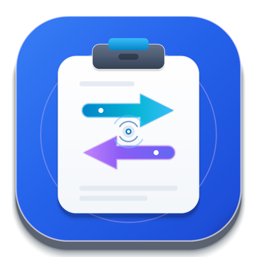

<p align="center">
  
</p>

# ClipRelay

Mac、Windows 与 Android 手机在同一局域网内互传文本和截图的小工具。选中或截图即发，对方直接粘贴。

- Windows 和 Mac 端使用 Electron。Windows 窗口由 HTML/CSS 复刻，剪贴板、热键、网络及后台服务继续调用原来的 PowerShell 5.1 / .NET 实现。
- Mac 将原 `init.lua` 的菜单、单目标发送、剪贴板恢复和发现逻辑迁入 Electron；首次启动导入原有 ClipRelay 设置。
- Android 端使用仓库维护的原生 APK，工程位于 `android-app/`，接收电脑发送的文本和截图。

## 工作原理

- 配对连接固定两端证书，使用双向 TLS 传输文本和图片。Windows 向 Android/Mac 的普通广播通过接收端长轮询 `/v1/relay` 完成；Android/Mac 主动发送使用 `/v1/clipboard`。
- 旧版兼容默认关闭。明确开启后才使用 HTTP `47632`（`/push`、`/push-image`）和旧版 mDNS 发现；Mac 的旧版 HTTP 只接收文本，配对连接可接收文本和 JPEG。
- Mac 按下 `Ctrl+Alt+G` 后，脚本模拟 `Cmd+C` 获取选中文本、恢复原剪贴板，再发送给对端。
- Windows 直接监听普通的 `Ctrl+C`：当前应用照常完成复制，ClipRelay 把新文本并行发送给所有启用的接收设备；若没有发生新复制，则发送剪贴板当前文本。
- Windows 按 `Ctrl+Alt+F12` 时，在内存中截取并编码所有显示器一次，再把同一份 JPEG 并行发送给所有启用设备；不打开截图界面、不写文件，也不改本机剪贴板。
- 对端收到后写入系统剪贴板并弹出通知，直接按 `Cmd+V` 或 `Ctrl+V` 即可粘贴。
- Windows 可维护最多 16 个广播目标；Mac 可保存 16 台配对电脑，每次选择一台收发。Android 在远控剪贴板面板中可主动收发，前台接收服务可接收配对广播。配对失败不会回退到旧版 HTTP。
- mDNS 声明包含随机设备 ID、显示名称、协议版本、平台、端口和认证状态，不包含访问密钥、剪贴板内容或历史记录。
- 原生 Android 默认使用“品牌 + 型号”作为发现名称（例如 `realme RMX5002` 或 `OnePlus PHK110`），并在 TXT 记录中分别声明 `brand` 和 `model`；设置页仍可覆盖成自定义名称。

## Mac 端

在 macOS 上使用 Node.js 22.12 或更新版本、Xcode Command Line Tools 构建：

```bash
npm run setup:electron
npm run build:mac -- arm64  # Intel Mac 使用 x64
```

产物位于 `.tools/mac-electron/`，解压后将 `ClipRelay.app` 拖入「应用程序」，通过 Finder 打开。源码安装也可运行 `bash mac-bootstrap.sh`。

1. 首次切换时，先停用 Hammerspoon 配置中的 ClipRelay 并 Reload，释放监听端口和快捷键。保留原配置文件，Electron 会读取其中的标准配置常量，以及 `hs.settings` 保存的设备、密钥、设备 ID 和发现开关；不会修改其他 Hammerspoon 配置。
2. 为 ClipRelay 授予「辅助功能」权限（系统设置 → 隐私与安全性 → 辅助功能），用于 `Ctrl+Alt+G` 获取选中文本。
3. 菜单栏 `ClipRelay` →「配对电脑与安全收发…」，输入可访问的电脑 IP 或主机名，默认远控端口 `48789`。在电脑端打开待配对列表，核对与 Mac 相同的验证码后确认。配对时无需共享账户密码或复制私钥。
4. 选择已配对电脑。`Ctrl+Alt+G` 会发送选中文本并恢复旧的纯文本剪贴板；「发送当前剪贴板」可主动发送文本或 PNG 图片，失败会显示原因。
5. 电脑端添加本 Mac 为「配对加密」广播目标后，Mac 会自动接收该电脑的文本和 JPEG。Mac 不为此打开接收监听端口；暂停、切换或移除电脑会取消正在等待的连接。移除只清理本机记录，电脑端授权请在电脑的设备列表中撤销。
6. 只有需要连接旧客户端时，才明确选择「使用旧版目标收发（未加密）」并开启旧版兼容；旧版设备仍可通过扫描或手工地址选择。

新配置位于 `~/Library/Application Support/ClipRelay/config.json`；之后启动优先读取此文件。`peer`、`peerPort`、`peerToken`、`localPort` 和 `hotkey` 可用于手动配置，修改后重新打开 App。构建包暂未签名或公证；本次按要求未进行 macOS 真机及安装包验收。`init.lua` 保留为迁移对照与旧版回退文件。

Mac 配对身份和主机记录保存在 `~/Library/Application Support/ClipRelay/paired/state.json`。私钥使用 Electron 的系统密钥保护功能加密保存；钥匙串不可用时拒绝配对，不降级保存明文私钥。后续 TLS 连接在发出 HTTP 请求前核对电脑证书；证书改变会停止连接。接收日志只保存消息 ID、摘要和处理状态，最多 4096 条；写入时清理超过一小时的记录，回执丢失不会重新覆盖剪贴板。

Mac 主动发送文本最多 1 MiB，PNG 最多 8 MiB、4096 × 4096 且不超过 600 万像素；接收 JPEG 最多 25 MiB、32768 单边且不超过 2400 万像素。配对电脑需可从 Mac 访问；开发分支的电脑控制电脑能力见后文，Mac 的内置跨网配对界面和被控端能力仍待实现。

协议测试可运行 `node --test windows/tests/mac-pairing.test.cjs windows/tests/mac-paired-relay.test.cjs windows/tests/mac-controller.test.cjs windows/tests/mac-owned-window.test.cjs`（测试用 Go 生成临时证书）。`TestMacClientRealRelayAndDesktopWorker` 验证真实 Go mTLS 接口到 C# 模拟剪贴板 worker；`windows/tests/mac_sunshine_pairing.py` 在 Windows 上启动隔离 Sunshine 验证真实配对握手，关闭输入与托盘，退出时清理私钥和测试进程。这些测试不替代 macOS App 构建、钥匙串及系统剪贴板验收。

## Windows 端

支持 Windows 10/11 x64，安装包内含 Electron，后台继续使用系统自带的 Windows PowerShell 5.1。安装脚本会：

- 把客户端和配置写入 `%LOCALAPPDATA%\ClipRelay`；
- 注册当前用户登录自启；
- 为监听端口添加仅限“专用网络”的入站防火墙规则；
- 安装后立即启动，系统托盘出现 ClipRelay 图标即表示运行中；
- 左键点击托盘图标可打开深色“设备链路”控制台，查看并一键复制本机主机名（`.local`）或局域网 IP；
- 控制台集中显示本机监听状态、文本/截图快捷键及冲突状态、广播链路和最近一次传输结果；
- 左侧设备列表可直接开关每台目标，通过 `···` 编辑或移除设备；支持添加和扫描最多 16 个目标，名称、地址、端口和访问密钥独立配置；全部关闭时暂停发送，本机仍可接收；
- 支持修改本机监听端口、接收密钥、通知和开机自启，并可并行检测所有广播设备。

从完整离线包安装：解压整个 `ClipRelay-Windows-*.zip`，双击 `Install.cmd`。源码构建需要 Node.js 22.12 或更新版本、Go 1.26.7，以及已登录的 GitHub CLI。在同一个系统 PowerShell 5.1 会话中运行：

```powershell
npm run setup:electron
& .\scripts\resolve_windows_components.ps1 -OutputDirectory .tools\windows-components
& .\scripts\package_windows.ps1
```

`windows/components.json` 固定已验证的 Windows 播放器、桌面网络组件和修改版 Sunshine 构建。下载时核对构建成功状态、源码提交和文件摘要；构建产物过期时需重新构建、核验并更新固定版本，不会自动选取另一个版本。已有本地组件时，可向打包脚本分别传入 `-ViewerArtifact`、`-NetworkArtifact` 和 `-EngineArtifact` 目录。

完整包包含桌面主控、被控服务、网络组件、许可和引擎修改源码。安装器先校验整包，再停止旧应用；缺文件或摘要不一致时不会继续安装。升级保留原配置中的设备身份、配对目标、端口、兼容开关及其他设置。可在解压目录中先运行只读校验：

```powershell
powershell.exe -NoProfile -STA -ExecutionPolicy Bypass -File .\ClipRelay-Windows\install.ps1 -ValidateOnly
```

不支持只下载一个 `install.ps1` 或从未打包的源码目录直接安装。`Windows Complete Package` 工作流在一次性 Windows 机器上构建并验收，产生检查记录和 ZIP，不发布更新。

完整包已通过 [Windows CI 实际安装验收](https://github.com/ffffhx/cliprelay/actions/runs/38712007226)：验证 SYSTEM 服务管道、安装命令退出后的 Electron/后台/监听存活、默认关闭旧版接收，以及 Electron 退出后的后台管道清理。该验收不包含真实硬件串流、用户界面操作或公网远控；尚未替换开发电脑上的正式安装。

添加防火墙规则时会出现一次 UAC 确认。安装后添加配对设备，或在两端明确开启旧版兼容，正常按 `Ctrl+C` 即会同时复制
到本机并广播；按 `Ctrl+Alt+F12` 会静默广播整个虚拟桌面的 JPEG 截图。接收的文本或
截图会进入剪贴板。

配置保存在 `%LOCALAPPDATA%\ClipRelay\config.json`。左键点击托盘图标，或右键选择
`设置 / 配置对方设备...`：在“这台电脑”中切换本机主机名 (`.local`) 与局域网 IPv4，点击 `复制` 后发给对方；
左侧列表始终显示所有已保存设备，开关决定该设备是否接收广播，停用后仍留在列表中。点击 `+ 添加` 可手动添加，点击 `扫描添加设备` 可发现局域网目标并合并到列表；通过每行的 `··· → 编辑设备 / 移除设备` 管理名称、地址、端口和密钥，修改立即保存。检测连接只探测已启用设备，不会修改任何剪贴板。
“检测全链路连接”会先在后台扫描局域网，按设备 ID 更新已有目标的 IP 和端口并自动保存，再检测连接；不会自动新增目标，也不会改动名称、密钥或启用状态。未发现的设备仍按已保存地址检测，扫描失败时也会回退到已保存地址。
文本和截图发送遇到连接失败或超时时，会在允许局域网发现的情况下扫描一次（约 1.8 秒）；仅当同一设备 ID 的地址或端口发生变化时，保存新地址并重试一次。已成功设备不重发，密钥/HTTP 错误不重试；未发现新地址则保留失败结果。自动恢复要求设备已通过扫描关联到真实设备 ID，不能仅凭相同名称识别手动添加的设备。
在设置中可修改“局域网发现名称”或关闭“允许局域网发现”；这两项变化会在保存后重启后台服务。
广播时单台设备离线不会阻止其他设备接收；界面会显示“全部送达”“部分送达”或“全部失败”，并保留逐设备结果。
如果修改监听端口，ClipRelay 会申请更新专用网络防火墙规则并自动重启；这一步可能出现 UAC 确认。
设备列表中某个目标的访问密钥，需要与该目标自己的“接收密钥”一致；主窗口的“本机接收密钥”只保护发往这台 Windows 电脑的请求。留空则兼容未启用认证的旧客户端。
卸载命令：

```powershell
powershell.exe -NoProfile -ExecutionPolicy Bypass `
  -File "$env:LOCALAPPDATA\ClipRelay\uninstall.ps1"
```

如只想从仓库临时运行，先准备 Electron，再通过独立启动脚本拉起（不运行安装器）：

```powershell
npm run build:windows
powershell.exe -NoProfile -STA -ExecutionPolicy Bypass `
  -File .\windows\start.ps1 -OpenSettings -Peer 192.168.1.100
```

安装后的应用入口是 `%LOCALAPPDATA%\ClipRelay\desktop\ClipRelay.exe`；登录自启使用 `--background`。`start.ps1` 通过独立 helper 启动应用，终端退出后托盘和接收服务继续运行。Electron 与原后台通过随机命名管道通信；关闭设置窗口不退出后台，托盘「退出」会同时结束 Electron 与后台。

迁移回归：`npm run test:electron`；Windows 原生桥接和 HTML 交互测试分别运行 `windows/tests/run-electron-live.ps1`、`windows/tests/run-electron-live.ps1 -Mode renderer`（系统 PowerShell 5.1，`-STA`）。脚本独立启动隔离测试 App 并输出结果目录，最终查看其中 `test-results/results.json` 的 `complete: true`；截图也在该目录。测试配置使用独立端口，配置保存不会改动用户的开机快捷方式。

## Android 端（原生 APK）

原生工程位于 [`android-app/`](android-app/)，支持 Android 8.0 及以上版本。App 会运行一个
带常驻通知的前台接收服务，支持文本 `/push` 和截图 `/push-image`。收到内容后会：

- 将文本或截图写入手机系统剪贴板；
- 弹出可关闭内容预览的通知；
- 在 App 内保留最近 30 条文本与截图，点击进入无系统栏的沉浸式全屏，左右滑动切换；全屏图片支持 1×–5× 双指缩放与放大后拖动，拖到左右边缘后松手，再向外滑动可切换相邻的图片或文字；轻点内容可显示复制、关闭及横竖屏控制；
- 根据设置在手机重启或 App 更新后恢复接收。

文本全屏阅读默认渲染 Markdown，支持标题、列表、引用、表格、链接及带语法高亮的代码块。
预览保留原文中的单次换行，避免复制来的多行文字被合并为同一段连续文字。
独立段落间留一行空白；连续列表项紧凑排列，原文在列表项间留有空行时使用较大间距，嵌套列表分别判断。
预览字号旁可切换深色（黑底白字）和浅色（白底黑字），选择会保存，原文、Markdown、代码高亮和控制栏同步换色；设置页也可调整“预览暗黑模式”。
顶部可切换“查看原文 / Markdown 预览”，全文复制始终保留原始 Markdown；代码块支持横向滚动和“复制代码”。
轻点正文可显示或隐藏控制栏，字号调整、横竖屏和左右切换历史仍可使用。此功能渲染收到的文本，不涉及 `.md` 文件传输。
全屏控制栏直接覆盖正文，显示或隐藏时不改变正文位置。阅读期间收到新文本或图片时，会显示
“收到 N 条新内容 · 点击查看”，约 4.5 秒后收为“新内容 N”提示，直到点击查看或忽略；手动滑到新内容并停下时也会扣除对应提醒，全部看过后自动消失。不自动跳走当前阅读记录。

收到的图片可在历史卡片或全屏预览的控制栏点击“保存到相册”，原图会复制到 `Pictures/ClipRelay`，清空接收历史不会删除已保存的相册图片。Android 8–9 首次保存时需允许存储权限。
本次打开 App 期间，操作成功的内容会显示“已保存”或“已复制”，列表与全屏同步；切到后台或旋转屏幕保留状态，关闭 App 页面或结束进程后重新打开恢复默认文案。“已复制”仍可再次复制，“已保存”不重复写入相册。

### 使用 APK

1. 安装由 GitHub Actions 产出的 `ClipRelay-android-debug` APK，或按下节自行构建。
2. 手机与电脑连接同一个可信局域网，打开 App，点击“开始接收”。
3. 按系统提示允许“本地网络”和通知权限。部分厂商还需把 ClipRelay 的电池策略改为“不受限制”。
4. App 会显示 `192.168.x.x:47632` 一类地址，并在“允许局域网发现”开启时自动声明自己。在 Windows 托盘面板左侧点击“扫描添加设备”即可添加手机；扫描不到时仍可点击“+ 添加”手动填写 IP。
5. 在电脑正常按 `Ctrl+C` 可发送文本；按 `Ctrl+Alt+F12` 可发送所有显示器的截图。收到的内容会直接进入手机剪贴板。

访问密钥默认为空。若在 Android 启用，Windows 的对应广播设备也要填写相同密钥，发送请求会携带
`X-ClipRelay-Token: <密钥>`；缺失或错误的密钥会收到 `401`。

Android 0.10.11 起，可在接收设置中开启「调试时保持亮屏」（默认关闭）。接收服务运行时，只要系统的 USB 调试或 Wi-Fi 调试任一开启，就阻止自动息屏，包括未充电、切到其他 App 的情况；两项都关闭、关闭此选项或停止接收后恢复系统原有息屏规则，不修改原来的息屏时间。手动按电源键仍可锁屏。此功能依赖系统允许 App 读取调试开关，已在 Android 13 真机验证；部分较新系统可能限制读取。

### 本地构建

需要 JDK 17、Go 1.26.7、Android SDK Platform 37 和 NDK 29.0.14206865。远控客户端源码已内置于
`android-app/remote-engine/`，首次构建会同时编译原生解码/传输模块。在 Windows PowerShell 中：

```powershell
$env:ANDROID_HOME = "$env:LOCALAPPDATA\Android\Sdk"
python scripts/build_network.py android
cd android-app
.\gradlew.bat lintDebug testDebugUnitTest assembleDebug
adb install -r .\app\build\outputs\apk\debug\app-debug.apk
```

可安装的 Debug APK 位于 `android-app/app/build/outputs/apk/debug/app-debug.apk`。正式分发时
请使用自己的 Android 签名密钥构建并签名 Release APK；不要把签名文件提交到仓库。

已有正式版的真机可使用相同签名的 QA 构建运行 Markdown 界面测试：配置本地签名后，执行
`./gradlew connectedQaAndroidTest -PcliprelayTestBuildType=qa`。测试覆盖预览/原文切换、字号、代码复制、
横向滚动与横屏，并在 App 的外部文件目录保存 `markdown-*-qa.png` 截图；测试结束后安装正式 Release 包。
手动验收文本见 [`android-app/markdown-preview-demo.md`](android-app/markdown-preview-demo.md)。

### App 自动更新

正式版会在启动时检查更新，接收服务运行期间每 24 小时再检查一次。发现新版后，App 会显示
更新说明并下载 APK；下载完成后需要按 Android 系统提示确认安装。安装包必须满足以下条件才会
交给系统安装器：

- `versionCode` 高于当前版本；
- 包名仍为 `com.cliprelay.app`；
- APK 签名与已安装版本一致；
- 文件 SHA-256 与发布清单一致。

更新源默认是腾讯云 HTTPS 服务，版本清单和 APK 都从腾讯云下载，手机无需连接 GitHub。部署说明见
[`deploy/README.md`](deploy/README.md)。推送 `android-app/`、正式发布工作流或版本脚本的改动到 `main`
后，`.github/workflows/android-release.yml` 会自动运行测试、构建签名 APK、创建
`android-v<versionName>` 标签，并发布 APK 与更新清单。无需手动修改版本号：如果当前版本不高于
已发布版本，工作流会递增补丁号和 `versionCode`，验证构建成功后将版本修改提交回 `main`；
手动指定的更高版本号会保留。没有未发布的 Android 改动时，重复运行不会产生新版本。
发布任务串行执行，并取最新 `main`；构建期间分支有新提交时不会强推覆盖，后续任务会处理最新代码。
随后 Android Cloud Sync 会同步文件到腾讯云，并校验线上版本和 APK 哈希；失败时可单独重跑同步工作流。
手工推送形如 `android-v0.6.0` 的标签或从 Actions 手动运行工作流仍可作为发布兜底。
仓库需要预先配置
`CLIPRELAY_KEYSTORE_BASE64`、`CLIPRELAY_STORE_PASSWORD`、`CLIPRELAY_KEY_ALIAS`、
`CLIPRELAY_KEY_PASSWORD` 四个 Actions Secrets；这些值必须始终对应首次正式安装使用的签名密钥。
手工标签必须等于 `android-v<versionName>`，且指向本次构建的提交，否则发布工作流会直接失败。

OPPO、realme 等带厂商后台管理的手机，还需要在 ClipRelay 的“耗电管理”中开启“允许应用自启动”
和“允许完全后台行为”。否则厂商系统可能拦截 `MY_PACKAGE_REPLACED`，导致 App 更新后要手动打开一次
才能恢复接收。标准 Android 设备不需要额外设置。

Android APK 当前支持接收电脑发送的文本和截图，尚未提供“手机 → 电脑”的发送功能。

## 配置项

Mac 配置位于 `init.lua` 顶部：

| 配置 | 默认值 | 说明 |
| --- | --- | --- |
| `DEFAULT_PEER` | `peer-mac.local` | 尚未扫描选择设备时使用的手动回退地址 |
| `LOCAL_PORT` | `47632` | 本机 HTTP 接收服务和 mDNS 声明端口 |
| `HOTKEY_MODS` / `HOTKEY_KEY` | `ctrl` `alt` + `g` | 全局热键，冲突可改 |

Mac 扫描选择的 `peer`、`peerPort`、`peerToken`，以及稳定的 `deviceId` 和发现开关保存在 Hammerspoon 的 `hs.settings` 中。

Windows 配置位于 `%LOCALAPPDATA%\ClipRelay\config.json`：

| 配置 | 默认值 | 说明 |
| --- | --- | --- |
| `peer` | 安装时的 `-Peer` | 兼容旧版本的首个启用目标地址；实际广播以 `peers` 为准 |
| `peers` | 从 `peer` 自动迁移 | 广播目标数组；手动项包含名称、地址、端口、访问密钥和启用状态，扫描项还会保存设备 ID、平台和认证状态 |
| `port` | `47632` | 本机接收服务端口 |
| `notifications` | `true` | 是否在收到文本时弹出系统气泡通知（设为 `false` 进入静默同步模式） |
| `accessToken` | 空 | 本机接收密钥；本机在非空时拒绝缺失或错误的 `X-ClipRelay-Token` |
| `deviceId` | 首次安装生成的 UUID | 用于扫描去重和排除本机，不随设备名称或 IP 改变 |
| `deviceName` | Windows 计算机名 | mDNS 中显示的发现名称 |
| `discoveryEnabled` | `true` | 是否通过 mDNS 向当前局域网声明本机 ClipRelay 服务 |

Windows 当前监听不带其他修饰键的 `Ctrl+C`。按键不会被 ClipRelay 拦截，前台应用
仍按原方式完成复制；剪贴板更新后发送新文本，等待约 300 毫秒仍未更新时发送剪贴板当前文本。
剪贴板为空或只有图片、文件等非文本内容时不发送。可以先点击网页的“复制”按钮，再在没有选中文本的位置按 `Ctrl+C` 发送；
若当前应用把 `Ctrl+C` 解释为复制整行等操作，则发送该操作产生的新文本。左键点击
托盘图标可打开设备链路控制台，配置广播设备、本机端口、本机接收密钥、开机自启和接收气泡通知（静默模式）；也可右键托盘图标快速切换通知状态或选择 `退出 ClipRelay`。
同一段文本在 1 秒内连续按普通 `Ctrl+C` 只发送一次；不同文本仍会立即逐条发送，发送失败也不会阻止下一次重试。
广播设备列表变化后，防抖签名也会随之变化；新增目标不会被上一条单设备发送记录误抑制。

截图快捷键固定为 `Ctrl+Alt+F12`。它会被注册为全局热键，不再传给前台应用。
ClipRelay 启动时会检测系统级热键冲突：
注册成功时托盘菜单显示“可用”；如果已被其他程序占用，托盘菜单显示冲突并弹出一次警告，
截图功能保持停用，但 `Ctrl+C` 文本同步和接收服务会继续运行。截图覆盖
整个 Windows 虚拟桌面（所有显示器），以质量 88 的 JPEG 在内存中只编码一次，再通过并行的 `/push-image`
请求广播；发送端不调用系统截图 UI、不写临时文件、不修改本机剪贴板，成功或失败也不会弹通知。
接收端会拒绝超过 25 MiB、格式错误或像素尺寸异常的图片。

## Windows 版本更新

首次安装可直接[下载 Windows v0.1.0 安装包](https://124-221-36-36.anyip.dev:8443/cliprelay/windows/ClipRelay-Windows-0.1.0.zip)，
解压整个文件夹后双击 `Install.cmd`。这个版本已经包含下面的更新提醒功能。

Windows 控制中心右下角和托盘菜单都有「版本更新」入口。客户端启动 10 秒后检查新版，
运行中每 15 分钟再检查一次；不要求朋友与你在同一局域网。发现新版后显示系统通知，
控制中心保留新版入口。同一版本只通知一次，更新通知可以单独关闭，不受剪贴板气泡开关影响。
系统专注模式可能隐藏气泡，仍可从控制中心查看。

更新窗口展示当前版本、新版本和本次更新说明，点击「下载新版」后在后台下载并校验 SHA-256
和文件大小。关闭更新窗口不会中断下载；下载完成后点击「打开下载位置」，解压 ZIP，再双击
`Install.cmd` 安装。设备列表、访问密钥、本机端口及开机启动选择会保留。
不会自动安装或在共享屏幕时强制重启。首次安装的朋友可在控制中心添加或扫描设备。

Windows 更新源：`https://124-221-36-36.anyip.dev:8443/cliprelay/windows/update.json`。
发布者修改 [`windows/version.json`](windows/version.json) 和
[`windows/release-notes.txt`](windows/release-notes.txt)，提交后运行 GitHub Actions 的
`Windows Release`，或者推送 `windows-vX.Y.Z` 标签，即可构建安装包、发布更新说明并同步到云端。
发布流程见 [`deploy/README.md`](deploy/README.md#Windows-发布)。
旧版 Windows 客户端没有更新检查功能，需要先安装一次带这个功能的版本。

## 手机远程操作电脑

Windows 安装包内置远控引擎；Android APK 内置客户端。双方只需安装 ClipRelay，
不用单独安装 Sunshine、Moonlight 或 Tailscale，也不需要注册 Tailscale 账号。
内置外网连接优先尝试设备直连，无法直连时使用 ClipRelay 服务器中转；手机可以使用移动网络。

1. 电脑运行 ClipRelay 安装程序，允许安装 `ClipRelay Remote Desktop` 后台服务。
2. 打开电脑 ClipRelay 的「手机远控」，点击「开启远控」。首次安装默认关闭。
3. 手机和电脑连接同一局域网，手机首页点击「连接电脑」，电脑会自动出现在列表中，点选即可发起配对。
4. 核对手机和电脑显示的确认标识，在电脑「手机远控」中允许一次即可，不需要手填 IP 或 PIN。旧版电脑继续使用四位 PIN。
5. Android 0.10.17 起，点击「连接这台电脑」后直接进入画面，首次配对完成也会自动连接；已有串流时自动恢复，无需再打开连接选项或点击恢复串流。电脑有其他游戏串流时会恢复该串流，不会将其关闭。Android 0.10.13 起，横屏时如果桌面画面两侧留有足够宽的黑边，操作按钮会自动常驻在左右黑边中，无需收起或展开；按钮较多时可在侧栏内上下滑动，中央桌面画面保持原来的大小。侧栏避开屏幕缺口、系统栏与手机键盘。没有足够黑边时，仍可点右侧边缘的半透明「⋯」展开底部工具栏，小圆点可上下拖动并记住位置。
   工具栏中的「触控」可选择手机触控、直接点击或触控板，选择会保存到下次连接，也可在「画质与操控 → 触控方式」中修改。
   Android 0.10.19 起，展开工具栏点「返回电脑列表」（游戏模式在右上角菜单中），或使用系统返回，直接回到带「重新扫描」「其他添加方式」的电脑列表，不再弹出画中画小窗。返回时停止手机端画面接收并释放键鼠控制，电脑上的应用和会话保留；再次点击这台电脑即可恢复控制。键盘打开时，系统返回仍先收起键盘。

Android 0.10.12 / Windows 0.3.4 起，局域网发现同时使用 ClipRelay mDNS 和 UDP `47634` 查询，后者绑定 Wi-Fi / 有线网卡以兼容手机开启 VPN 的情况；只返回设备名和服务端口，不广播凭据。首次授权通过独立的 TLS `48792` 通道，两端确认标识绑定电脑证书、手机证书和随机数，电脑通过本机受保护的控制接口允许后才提交远控配对。等待两分钟自动过期，手机可以取消。配对证书立即保存，重启保留；重新发现按远控 UUID 合并地址并核对保存的证书，IP 变化不会新增重复电脑或重置配对。手动 IP 和外网配对码在「其他添加方式」中。

需要从外网连接时：电脑「手机远控 → 外网配对」开启内置通道并生成八位配对码；
手机「连接电脑 → 其他添加方式 → 用配对码添加」输入该码。核对两边显示的六位标识，在电脑允许这台手机，
待手机显示就绪后点击「连接电脑」。如果此前已在局域网完成配对，外网连接会沿用授权；仅通过外网首次配对时，仍需在电脑端输入手机显示的四位 PIN。
配对码五分钟有效、只能使用一次。之后打开电脑列表即自动恢复已启用的通道，并按电脑身份合并局域网和安全通道地址，不需要选择内外网模式。

Android 0.10.8 起，内置通道会自动重建异常退出的 UDP 转发端口，避免电脑仍显示在线但实时控制无法握手；恢复期间显示「正在恢复串流通道」。内置通道连接失败时提供重试提示，不再显示原引擎不适用的公网 47999 端口建议。
Android 0.10.6 起并行探测保存的地址，优先选局域网；内置通道已响应时，最多额外等待 400 毫秒争取更优先的路径，避免失效的旧地址拖住连接。每条路径仍核对电脑身份并使用已保存的配对证书。此选择发生在连接前；串流中换网可能仍需重新连接。
手机「暂停安全通道」会保留配对且仍可局域网直连；电脑可分别关闭外网连接、撤销外网配对或撤销远控授权。
手机可保存多台电脑的外网配对，各自建立独立的安全通道；在电脑列表中选择目标即可连接，无需重新输入配对码。升级会保留旧配对及原地址，添加新电脑失败或取消时不影响已有电脑。每台电脑仍最多允许八台手机。
在「连接电脑 → 其他添加方式 → 用配对码添加」进入外网电脑管理页，可继续添加其他电脑，并逐台暂停、恢复或移除。移除只删除这台手机保存的对应外网配对；其他电脑和局域网发现不受影响，电脑端仍可撤销远控授权。通知栏的「全部暂停」保留全部配对，之后可逐台恢复。每台电脑的设备凭据、网络状态目录及本地转发地址相互独立。
此版本内置外网通道用于手机远控；剪贴板同步和电脑之间的屏幕共享仍使用原有设备地址与访问密钥。

设备密钥保存在各端私有目录中，Android 的设备凭据由系统 Keystore 加密并排除备份。
配对与协调服务部署在现有腾讯云更新服务器上，设备之间使用 WireGuard 加密。
不同电脑的配对组由服务端访问规则隔离，电脑还会检查手机地址白名单；公网不开放远控管理接口。
中转会消耗服务器带宽，适合个人使用的容量需按实际串流码率规划；直连画面不经过服务器。

「手机触控」将手指操作作为真实触屏输入传给电脑：点按、单指滑动滚动、双指捏合缩放和长按菜单由电脑软件处理。
Android 0.10.28 起，手机和平板统一默认 1920×1080、60 FPS，默认使用「手机触控」。升级时原有 1280×720 / 1280×960 设置一次性调整为 1080P，其他分辨率及帧率保持原选择；之后手动选择较低分辨率仍会保存。已经明确选择的触控模式仍会保留。返回电脑列表后，右上角齿轮进入「画质与操控」，可更改分辨率和触控模式。两端共用同一套工具栏：两侧空白足够时显示侧栏，否则使用底部菜单；按钮按应用模式展示，已移除聊天工具栏中的「换行 ⇧Enter」。
手机触控默认发送原生触屏手势，使用 Windows 的圆形触点反馈。Android 0.10.30 起，识别到 Orca 前台应用时，单指保持原生触控，双指张开／捏合转换为 Ctrl+=／Ctrl+- 调整当前终端字号，双指平移转换为滚轮。先点选目标终端；需要保留 Orca 默认缩放快捷键。手势经过防抖后锁定为缩放或滚动，抬起任一手指、加入第三指、切换应用或失去焦点即结束，不会把剩余手指变成点击，也不会持续按住 Ctrl。直接点击和触控板模式仍使用双指滚动。
Android 0.10.26 起，识别到 ChatGPT / Codex 前台应用时，单指滑动自动转成鼠标滚轮，兼容其禁止触屏滚动的会话侧边栏；滚动固定作用于手指起点，轻点左键、长按右键，滑动结束不会点击会话。双指在开始滚动前落下时仍发送原生捏合手势；已开始单指滚动后加入第二指会取消本次手势。其他应用保留原生触控。手势兼容根据电脑实际前台应用自动生效，不需要选择专用工具栏；旧电脑端没有应用识别时，可以通过「更多 → 触控方式」使用直接点击或触控板的双指滚动。需要拖拽会话排序或选字时可使用直接点击模式。
滚动、缩放和选字效果取决于软件的触屏支持，电脑界面不会变成手机版。「手机触控」点进可编辑输入框后会自动弹出手机键盘，点到普通按钮或只读区域后收起自动打开的键盘；手动收起后不会反复弹出。
自动键盘需要新版 Windows 端和 Android 端。自绘控件、部分游戏或旧版电脑端可能无法提供输入焦点，此时仍可从工具栏打开「手机键盘」。
Android 0.10.27 起，ChatGPT / Codex 的兼容触控在手机画面上显示跟手圆点，抬手后淡出；切换模式、切换应用或取消手势会立即清除。圆点由手机本地绘制，不接收点击，不会影响滚动落点，也不改变 Windows 的系统光标；原生触控和双指手势继续使用电脑端原有反馈。
Android 0.10.22 起，输入法反复修订语音识别或拼音候选时，临时文字和组合范围保留在手机端，确认文字后才转发到电脑，避免将每次识别的半句话重复追加。正常连续输入相同词句仍会逐次发送。
如果手机连接了实体键盘，或 scrcpy 使用了键盘模拟，Android 可能禁止显示手机键盘。请在手机系统「实体键盘」设置中开启「使用屏幕键盘」。Android 0.10.5 同时修复了前台应用识别更新时取消刚刚点击后的键盘检测的问题；手动收起、切后台与断开连接仍会取消检测。
电脑通过 Windows UI Automation 核对轻点位置是否命中当前可编辑输入框，不读取文字、控件名称或密码。切换会话后自动获得焦点、点击空白处仍保留输入焦点，都不会自动弹出手机键盘；重新点击输入框才会唤起。此判断需要新版电脑端和手机端，旧版电脑端保留手动键盘入口。焦点通道使用现有远控配对证书进行双向 TLS 验证，撤销配对后立即停止访问。
拖动窗口、精确选字或操作老软件时可以切回「直接点击」「触控板」。不支持触屏输入的电脑会提示并切换为直接点击。
手机触控中的三指手势也传给电脑，不使用旧模式的三指唤起键盘；切换模式、失焦、旋转及断开连接会取消触点。

操作模式只保留「通用桌面」与「游戏模式」，通过「模式」按钮手动选择；默认进入通用桌面，旧的 ChatGPT / Orca 工具栏选择不再生效。切换电脑前台应用不会改变操作模式或游戏按键布局。后台应用识别仅用于触摸兼容和切换应用时释放输入，只传输预设应用标识，不读取或传输窗口标题、应用路径及内容，沿用远控配对加密通道。
通用桌面左侧依次为模式、手机键盘、虚拟键盘、语音输入、传图片；右侧依次为返回电脑列表、Enter、退格图标、Esc、Win、更多。复制、粘贴、全选、触控方式、撤销、重做、上下滚动、串流信息和断开连接统一放在「更多」中。画面两侧空间不足时，底部工具栏提供相同按钮。模式切换释放旧按键和触点，不会启动应用或向应用发送文字。

开发版侧栏、底部工具栏与「更多」中增加「自定义键」。可保存最多 12 个具名快捷键，选择 Ctrl / Alt / Shift / Win 与字母、数字、F1–F24、导航键等组合，并支持编辑、删除、上移和下移。配置保存在本机，供各台远程电脑共用；点按时先按修饰键，松开时先释放普通键，结束后不保持任何按键。游戏布局和 Orca / ChatGPT 控件继续独立使用。
复制、粘贴操作的是电脑剪贴板；滚动作用于电脑鼠标所在区域。

「虚拟键盘」在手机底部展开电脑按键，提供字母、数字、Ctrl、Alt、Shift、Win、Tab、Enter、退格、空格与方向键；「功能 / 符号」页包含 F1–F12、Esc、Delete、Insert、Home、End、Page Up/Down 和标点。先点亮修饰键，再点其他键发送组合（例如 Ctrl → C、Ctrl → Shift → Esc）；组合完成自动松开，再点同一个修饰键可取消选择，长按修饰键则单独发送该键。选中的修饰键仅用于下一次虚拟键盘按键，不用于电脑画面上的鼠标点击。
点击「收起」或手机返回键关闭面板；「手机键盘」保留系统输入法，适合输入中文。游戏模式可从右上角「⋯ → 虚拟键盘」打开，收起后恢复游戏按键。失焦、断开、切换应用、旋转和关闭面板会清除未发送的组合键，键盘区域不会把触摸传给电脑画面。

Android 0.10.23 / Windows 0.3.5 新增侧边栏「语音输入」：先选中电脑输入框，点击按钮并允许手机麦克风权限，看到「请对着手机说话」后开始说话，点击「结束说话」由电脑豆包输入文字；不会自动按回车发送。使用的是手机麦克风，无需打开手机键盘，远离电脑也可使用。
电脑需要正在运行的豆包输入法，以及已启用的 Steam Streaming Microphone 或 VB-CABLE 虚拟声卡。ClipRelay 临时选择虚拟麦克风，结束后恢复原选择；不修改系统默认麦克风或音频格式。音频沿用现有远控配对的双向 TLS 通道，以 16 kHz 单声道 PCM 在内存中转发；识别由豆包处理，遵循豆包自身的联网与隐私设置。
每次最长约 3 分钟。切后台、断开、切换电脑窗口或 6 秒未收到声音数据时取消录音。当前适配 Windows 豆包 0.9.1.22 的本地接口；它会忽略模拟快捷键，因此无需修改快捷键。该接口不是公开 SDK，豆包升级到尚未验证的版本时会提示更新 ClipRelay，不继续发送不兼容的命令。
开发验证：`windows/tests/voice-input.ps1` 检查版本兼容限制；`-Live` 在专用测试输入框中用合成中文语音验证豆包转写与麦克风恢复，不录制真实麦克风。手机权限、生命周期与实际网络仍需真机验收。

开发版新增两种独立的手机语音方式：长按「语音输入」，或从「更多 → 语音输入方式」选择。本机识别使用 Android 12 及以上的 [公开本机识别接口](https://developer.android.com/reference/android/speech/SpeechRecognizer#createOnDeviceSpeechRecognizer(android.content.Context))，需要手机提供可用服务和对应语言模型；系统语音服务使用 Android 的公开识别接口，可能由其提供方联网处理。模式不会在失败时自动切换；原有电脑豆包入口与默认设置保留。手机识别最长 60 秒，最终结果先显示在手机上，可编辑后点「输入到电脑」，仅输入一段文字，不按回车。识别中的半句、重复或过期回调不会输入；后台、画中画、断线、显示切换或切换应用时取消。输入结果不保存为文件，失败后不自动重发。

输入能力验证：Android 256 项本地测试通过，包含 12 项语音状态与自定义键测试；4 项新增界面测试已编译，尚未运行。普通串流文本发送已改为标准 UTF-8 字节，避免 JNI Modified UTF-8 对非 BMP 字符的影响；语音确认路径同时检查底层队列返回值。`python android-app/tools/test_text_jni.py --java-home D:/jdk17` 使用原样生产 Java / JNI 方法与独立记录队列，验证中文、非 BMP 字符、零字符、长文本、返回码、空输入和原有调用入口，共 7 项通过。四种 Android ABI 构建和符号检查、QA、lint、签名通过；这些结果不代表真实手机语音、Android JNI 加载或远端显示已经验收。

先点选电脑上 Orca、ChatGPT 或其他支持图片粘贴的软件输入区，再点远控工具栏的「传图片」，会直接打开手机系统相册选择器。选好后通过现有配对加密通道上传，自动返回串流并执行一次 Ctrl+V，无需再次确认上传或手动粘贴，也不会自动按回车发送消息。取消选图会直接返回；上传失败可重试，不会触发粘贴。选择器仅授权选中的图片，不需要读取整个相册。支持手机可解码的常见图片，源文件上限 20 MB；大图适度缩小后转为 PNG，保留透明通道并去除源元数据，传输上限 8 MB。自动上传及粘贴需要 Windows 0.3.3、Android 0.10.10 或更高版本；选图期间暂停串流，电脑应用继续运行。

当前开发分支新增「更多 → 显示器」：通过配对通道列出、刷新和选择电脑上可采集的显示器，保留视频连接；切换时释放按住的按键和触控，等目标画面实际显示后恢复输入。自动键盘检测按当前显示器的物理坐标和画面黑边映射，拒绝过期串流或引擎重启前的请求。多台设备观看同一电脑时，切换会影响所有观看设备。需要配套的修改版串流引擎；现有安装尚未更新，实际多屏、热插拔与手机界面仍待验收。可识别已经安装且能采集的虚拟显示器，暂未提供虚拟显示驱动安装。源码补丁、构建与接口说明见 [engine/sunshine](engine/sunshine/README.md)。

当前开发分支新增「更多 → 隐私与锁屏」：手机前台远控时可遮住 Windows 电脑的显示器，本机按 `Ctrl + Alt + Shift + P` 恢复。仅允许当前唯一的已配对串流开启；退出、切后台、超时、配对撤销、显示器变化或引擎状态无法确认时恢复显示，恢复后需要用户再次开启。需要 Windows 10 2004 及以上、DWM 合成和配套修改版引擎。此功能是可由本机退出的桌面遮罩，不覆盖锁屏、UAC 等安全桌面，也不锁定本机键鼠。

当前开发分支新增电脑列表长按菜单「远程唤醒设置」。目标电脑在线且已配对时，读取 Windows 物理网卡、魔术包唤醒和电源设置；选择已连接的网卡，再选择目标局域网中另一台已配对、在线且运行新版 ClipRelay 的电脑作为助手。设置绑定两台电脑的配对证书，保存 30 天；目标离线后，从原「唤醒」菜单发送请求。手机可通过现有跨网通道联系助手，由助手向自己的局域网代发唤醒包。选择助手时需确认它确实在目标局域网；相同网段地址不代表一定属于同一个物理网络。没有助手时仍可明确选择「从当前手机发送」，通常需要手机在目标局域网。

`POST /v1/wake` 复用配对双向 TLS。助手只向当前已连接物理网卡的指定匹配网段广播固定的 102 字节魔术包，端口固定为 UDP 9，每个出口发三次；不接受任意目的地址、端口或命令。配对证书隔离请求回执，两分钟内相同请求不重复发送；每个客户端十秒最多一轮，全局每分钟最多六十轮。手机收到发送回执后最多等待一分钟，并通过目标电脑的固定证书再次读取状态，才显示「电脑已上线」。丢失回执、等待超时和硬件能力不明都有独立提示；退出页面会取消请求和等待，不后台自动重试。

网卡检测只读，不自动改 BIOS、电源设置、快速启动或网卡属性。配置已启用也不等于硬件唤醒已实测；[Windows 网卡电源管理定义](https://learn.microsoft.com/en-us/windows/win32/fwp/wmi/netadaptercimprov/msft-netadapterpowermanagementsettingdata)规定电源管理未启用时，其余设置可能没有定义，因此此类状态显示「待确认」。`windows/tests/wake.ps1` 验证检测逻辑；Go `TestWake*` 覆盖授权、局域网出口、重试、撤销和真实双向 TLS，UDP 内容测试只发往本机回环。Android `WakeStateTest` 覆盖协议、配置过期、证书绑定、取消及真实 Windows 检测输出；配置 `CLIPRELAY_WAKE_TEST_WORKER` 指向测试程序或完整服务程序即可运行跨进程检查。完整服务和 Android QA 包已构建，实际睡眠/关机唤醒、安装版 SYSTEM 服务和 Android 界面操作仍待验收。

`POST /v1/privacy` 使用双向 TLS，将操作绑定到配对证书、引擎实例、串流和随机租约；桌面用户 worker 独立计时，15 秒未续约即撤罩。遮罩使用 [WDA_EXCLUDEFROMCAPTURE](https://learn.microsoft.com/en-us/windows/win32/api/winuser/nf-winuser-setwindowdisplayaffinity)，不改变显示器电源、分辨率或音频。已通过生命周期、授权和恢复测试，以及生产遮罩在小型自有测试窗口上的真实 DXGI 捕获验证；正常退出与强制结束进程均移除遮罩。验证入口为 `windows/tests/privacy-screen.ps1`、`privacy_capture.py` 和 Go `TestPrivacy*`；捕获测试先用 LLVM-MinGW 编译 `privacy-capture.cpp`（`-D_WIN32_WINNT=0x0A00 -DWINVER=0x0A00 -ld3d11 -ldxgi -luser32 -lole32`），只读测试窗口内的一个像素。完整 Sunshine 编码串流、实际全屏/多屏与 Android 界面、SYSTEM 用户进程切换仍待验收；已安装服务未替换。被控端静音的实现和验收进度见下文。

同一菜单可独立开启「本次远程结束后锁屏」，默认关闭，仅绑定当前唯一的配对串流。`POST /v1/session-lock` 只接受 `status`、`arm` 和 `disarm`；手机不能直接提交锁屏，也不负责维持锁屏计时。电脑端每秒检查引擎，在持续空闲至少 1.5 秒后再次确认没有任何串流，再由桌面用户 worker 先移除隐私遮罩、后发起锁屏。短暂控制故障不表示会话结束；出现新串流、引擎重启、配对撤销、本机会话变化或持续无法确认状态会取消安排。切后台只恢复遮罩，已开启的结束锁屏安排继续由电脑端跟踪；服务或 worker 退出时不额外锁屏。

锁屏是一次性操作，回执丢失或用户解锁后都不重试。[LockWorkStation](https://learn.microsoft.com/en-us/windows/win32/api/winuser/nf-winuser-lockworkstation) 返回成功仅表示已发起，实际成功需收到本会话的 `WTS_SESSION_LOCK` 通知；没有通知会报告未确认。`windows/tests/session-lock.ps1` 用模拟工作站验证策略，Go `TestSessionLock*` 覆盖授权、撤销、引擎状态、断开判断和真实 worker 通信；测试没有实际锁定用户电脑。Windows 工作站锁定/解锁、完整 Sunshine 断开流程、Android 菜单及后台行为仍待实机验收。

被控端静音已接入桌面用户工作进程、配对控制接口 `/v1/audio-mute` 和手机“隐私与锁屏”菜单。菜单分别提供隐私屏、电脑扬声器静音、结束后锁屏，并显示当前状态；手机退出远程画面、后台或画中画时会请求恢复声音。接口只允许唯一的当前串流持有静音，并绑定音频采集代次；端点采集、音频未就绪或采集重建时拒绝开启或续期。断线、撤销配对、过期、工作进程失效、设备变化和本地手动调整会触发恢复；丢失响应后仍重试恢复，已取消的请求在两分钟重试窗口内不能重新开启。恢复记录存于桌面用户的 `%LOCALAPPDATA%\ClipRelay\audio-mute.json`，服务每分钟检查新出现的崩溃记录，未完成的恢复每 30 秒重试；工作进程自己还维持独立的 15 秒到期恢复。`windows/tests/audio-mute.ps1` 的 26 项场景、Go 的 11 组静音控制测试及 Android 的 221 项单元测试通过，QA 构建和检查通过。静音不修改音量或默认设备，并保留 Steam Streaming Microphone / VB-Audio 的语音输入通道。

修改版引擎的完整构建和加密串流音频测试已通过：已有、非默认的 Steam 虚拟扬声器上生成的测试音，经采集、Opus 编码、传输和解码后，静音前、静音中、恢复后的幅度均为 0.005031733，串流和音频采集代次不变，设备设置恢复一致。服务通过受信配置 `cliprelay_audio_exclude_pid` 指定自身 PID；引擎验证存活的父子关系和创建时间，排除服务及语音输入工作进程，避免回音。完整串流反例中，旧引擎会传回模拟语音输入的测试音，新引擎接收端测得为 0；普通应用的测试音仍正常传输。无声程序的独立采集也保持健康。复现入口为 `windows/tests/engine_control_test.py <engine目录> --stream-client <测试接收器> --audio-test <audio-loopback.exe> --audio-host-root`。测试未改变真实扬声器或保存原始音频。新采集使用 [Windows 按进程采集接口](https://learn.microsoft.com/en-us/samples/microsoft/windows-classic-samples/applicationloopbackaudio-sample/)（系统构建 20348 及以上），开发选项 `cliprelay_process_audio` 仍默认关闭，当前仅支持 48 kHz 双声道；其他情况保留原采集且不报告静音支持。真实声卡、SYSTEM 恢复、Android 实际操作和安装版整链路仍待验收，当前结果不代表这些项目已完成。

当前开发分支新增「更多 → 剪贴板同步」：在已配对电脑的远控中，主动发送手机剪贴板或取回电脑剪贴板，支持纯文本和图片；收到后手动粘贴，不自动向电脑应用发送按键，也不后台监听剪贴板。该入口使用双向 TLS 和保存的电脑证书，旧电脑端不支持时提示更新，不退回 HTTP。文字上限 1 MiB（UTF-8），图片转为 PNG 后上限 8 MiB、600 万像素；电脑桌面锁定时拒绝读取和写入。

接口为 `POST /v1/clipboard`，请求只允许 `read` 或 `write`；写入的随机请求 ID 按配对证书隔离，进程内保存最近 256 次写入摘要，近期重复请求只确认而不再次覆盖剪贴板。每次请求以及读取结果返回前检查配对撤销。Windows 的剪贴板 worker 使用登录用户令牌和 STA 线程，stdin 关闭后退出，不保存剪贴板历史。`windows/tests/clipboard-exchange.ps1` 使用模拟剪贴板测试；将生成的 worker 路径传入 `CLIPRELAY_CLIPBOARD_TEST_WORKER` 后，Go 测试还会验证真实 C# 跨进程往返。手机实际 UI、SYSTEM 到用户进程和服务部署仍待验收。

开发分支也新增普通 Windows `Ctrl+C` / 截图的配对广播：先完成手机远控配对，在 Windows「添加接收设备」中选择已配对的手机，并在手机开启接收。该目标固定绑定配对证书，不依赖局域网 IP；通过现有双向 TLS 通道传输，失败不会转为 HTTP。发送状态需等手机处理完成并返回回执。文本 JSON 上限 1 MiB，JPEG 上限 25 MiB；屏幕预览翻页控制暂不支持此新目标。

手机主动长轮询 `POST /v1/relay`，不新增手机监听端口。Windows 常驻服务使用受保护的本地管道向内存队列发布，发送前校验管道所属进程；队列总容量 64 MiB，每台手机最多 16 条未完成消息，内容最迟五分钟清理。手机保存消息 ID、摘要及处理状态，回执丢失后不重复覆盖剪贴板；处理中崩溃或无法持久化结果会拒绝该条消息，需要用户重新发送。接收记录最多 4096 条，保留一小时。新增 `windows/tests/paired-relay.ps1`、`paired-targets.ps1` 和 Android `RelayDeliveryTest`；设置 `CLIPRELAY_RELAY_TEST_WORKER` 可运行 Go 到真实 C# 发送器的协议测试。此链路已做本地协议与构建验证，Electron 实际界面、Android 前台服务和安装后的 SYSTEM 服务仍待验收。Windows、Android 和 Mac 的旧版 HTTP 收发现已改为明确开启的兼容模式，升级时保留地址和密钥，但不会自动允许明文传输。Mac 加密配对客户端已接入相同的证书握手和广播回执协议，支持选择一台电脑收发；Mac App 打包、系统钥匙串与实际界面仍未在 macOS 验证。

当前开发分支新增「文件传输」：在电脑列表长按已配对的在线电脑，或在远控「更多」菜单中进入。可浏览电脑用户目录、桌面、文档和下载目录；上传时支持系统文件选择器多选，下载时先勾选多个文件，再选择手机保存目录。队列显示进度，支持暂停、继续和取消；应用进程退出后保留记录，重新打开后由用户点击继续。进入文件页面会暂时停止视频串流，返回后重新连接；文件队列通过独立前台服务运行。

文件通道复用远控的双向 TLS 身份，电脑在每次请求检查配对撤销，文件读写使用登录用户权限。分块和完整文件均校验 SHA-256；同名文件自动改名，不执行收到的文件。Windows 暂不支持链接、联接点和带重解析属性的云盘路径；Android 下载先存入应用私有临时文件，校验后发布到所选目录，因此手机需要临时文件及最终文件的空间，保存目录需支持重命名。后台服务超过系统时限会保存进度并暂停。此功能尚未发布，Android 设备和实际 Windows 服务验收仍待完成。

开发验证：`windows/tests/file-transfer.ps1` 运行 Windows 文件路径、空间、续传和崩溃恢复测试；传入 `-TestWorkerOutput <路径>` 可保留隔离测试 worker。将该路径设置到 `CLIPRELAY_FILE_TEST_WORKER`，Android JVM 的 `FileTransferTest` 会额外运行 Java 客户端与真实 C# worker 的跨进程往返测试。`network/inputfocus` 覆盖双向 TLS、配对撤销和请求边界；Android 的 `FileDestinationTest`、`FileTransferUiTest` 使用独立临时目录、测试文档提供程序和模拟器内 TLS 服务，不连接用户电脑或读取真实文档。

独立终端已具备 Windows 后端与 Android 客户端，本地验证完成，设备与安装版验收仍待进行。Windows 后端接入 [ConPTY](https://learn.microsoft.com/en-us/windows/console/creating-a-pseudoconsole-session)，通过配对双向 TLS 的 `POST /v1/terminal` 管理交互式 cmd / Windows PowerShell 5.1。Shell 使用登录用户的非管理员令牌，拒绝继承 SYSTEM 或提升后的令牌；不自动加载 PowerShell 配置文件或 cmd AutoRun。每台配对设备最多四个运行中的会话，电脑总计最多八个，重新连接可列出原会话并按字节位置继续读取 UTF-8/VT 输出。每个会话保留最近 1 MiB 输出，超出时明确报告缺口；连续 30 分钟没有访问会结束会话。

创建会话和写入使用独立递增序号，丢失回执后的同序号重试不会再次创建 Shell 或输入命令；工作进程重启后，旧实例请求被拒绝。输入队列与输出均有容量限制，接口区分「输入已接收」和「已写入终端」，不把它们当成命令执行成功。服务每三秒同步配对授权；撤销配对会结束对应会话，工作进程二十秒收不到有效授权也会自行结束会话。关闭、退出及撤销使用独立进程 Job 清理 Shell 和子进程，输出处理与 ConPTY 关闭分线程进行，避免旧版 Windows 关闭时死锁。

开发验证：`windows/tests/terminal.ps1 -Native` 运行策略测试和独立 Shell 验收，覆盖真实 cmd/PowerShell、多会话、重复输入、输出续读、尺寸变化、撤销、子进程与 EOF 清理。将 `CLIPRELAY_TERMINAL_TEST_WORKER` 设置为生成的 `terminal-tests.exe` 或完整服务程序，可运行 Go `TestTerminal*` 的真实 TLS 到 ConPTY 验证。测试只在新建 Shell 中执行测试指令，不控制已有终端。Android 从电脑菜单或串流工具栏的「终端」进入，提供 PowerShell / CMD 多会话、UTF-8 / VT 画面、颜色、光标、备用屏幕、滚动历史、软键盘及控制键。渲染器基于固定版本的 Termux terminal-emulator / TerminalRenderer，来源和许可见 `android-app/remote-engine/src/main/assets/cliprelay-remote/termux/`。返回原会话按输出字节位置继续读取；输出过期时重置画面并明确提示，旧输出中的终端查询不会再次发送。退到后台暂停网络请求、丢弃未发送按键并使旧输入法连接失效；结果未知的那一条输入保留原序号与内容用于确认。服务实例或配对身份变化时不把旧命令转发到新会话。进入终端会暂停视频串流，返回后按原有流程恢复。

Android 终端现支持显式选择文字与复制：选择模式暂停新输出读取和远端尺寸调整，已有请求与输入确认继续完成；新输出、尺寸变化或会话切换会清除选区，避免复制到变化后的内容。可跨行、跨历史记录选择，中文宽字符和组合字符保持完整；单次复制上限 256 KiB。点「粘贴」才读取系统剪贴板中的纯文本，先展示可编辑预览，确认后发送；不读取 URI 内容，远端 OSC 剪贴板指令仍被忽略。控制字符会移除，换行可能执行命令。单次正文最多 4084 字节 UTF-8，加上括号粘贴标记后放在同一个 4096 字节协议请求中，避免后台清理或队列拒绝留下半段粘贴标记。预览绑定当前会话、连接和前台生命周期，旧确认不能发送到新会话。

文字选择与粘贴阶段，本地完整 272 项 JVM 测试通过，含真实 Windows Shell 的协议互通、重复命令验证，以及新增 12 项文本选择、UTF-8、粘贴与队列边界测试；QA 应用、设备测试包和 lint 检查通过。12 项终端设备测试已编译，覆盖输入法、选区失效、查询回应、粘贴整批提交和 Canvas 渲染，但尚未运行。实际 Android 界面、浅色/深色预览、剪贴板系统行为、中文输入法兼容、屏幕旋转、网络切换和安装版 SYSTEM 路径仍待验收。现有 Orca 和 ChatGPT 交互入口保持可用。

Android 终端进一步修复历史回放与新输出混在同次读取中的情况：按实际输出字节位置拆分，保留同一个 UTF-8/VT 解析器，新输出中的查询可正常回应。4 项新增解析器回归及本地完整 260 项 JVM 测试通过，无失败、错误或跳过；QA 应用、设备测试包、lint 与签名验证通过，未安装到设备。多电脑、文件传输、隐私与锁屏、助手唤醒、终端、输入工具及配对剪贴板的 Android 源码现纳入开发构建分支，保留已有版本号和 Orca 手势改动。此前桌面开发分支上的 Android CI 未包含这些本地新增源码，不能用作它们的构建验收。

完整 Android 源码提交 `67bec799` 的 [CI 构建](https://github.com/ffffhx/cliprelay/actions/runs/38784674666)现已通过。下载后的测试 XML 与本地 260 项用例清单完全一致：Linux 通过 257 项，跳过 3 项仅适用于 Windows 的文件、Shell 和网卡互操作测试；这 3 项均已在本地 Windows 通过。APK 的签名、17 个新增功能类、四个 ABI 的 UTF-8 JNI 导出及 Termux 来源/许可文件已核验。该包仅完成构建与内容验证，没有安装或执行新增设备测试。记录见 `.tools/uu-parity/android-publication-artifacts.json` 和 `.tools/uu-parity/terminal-replay-artifacts.json`。

文字选择与粘贴预览提交 `bb24687` 的 [Android CI](https://github.com/ffffhx/cliprelay/actions/runs/38789927499)已通过。下载的 XML 与本地 272 项用例清单完全一致：Linux 通过 269 项，仅跳过上述 3 项已在本地 Windows 通过的互操作测试。CI APK、本地 QA 应用与测试包均通过签名检查；新功能类、四个 ABI 的 UTF-8 JNI 导出、Termux 许可及宽字符高亮修改说明已核验。12 项终端设备用例确认已包含在本地测试 APK 中，尚未执行；没有安装到模拟器或替换现有应用。记录见 `.tools/uu-parity/terminal-interaction-artifacts.json`。本次仅修改 Android，Windows 与 Mac 沿用已验证的包。

Android 终端新增显式「鼠标点击/滚动」模式。远端程序请求鼠标输入、历史回放完成且尺寸已确认后可开启；默认触摸仍滚动本地历史。轻点发送左键点击，上下滑动或外接鼠标滚轮滚动远端程序，单个事件最多发送 8 个滚轮步进。点击在抬起时将按下与松开编码为一个完整协议请求；取消、多指、越界、尺寸变化、会话更换、失焦或进入后台不会留下待发的半个点击。选择文字和打开对话框会退出鼠标模式。SGR 与 legacy 编码使用实际 VT 解析器；legacy 超出坐标范围时提示不可用，不点击其他位置。按住拖拽、右键/中键、鼠标修饰键与悬停报告仍待实现，不能视作完整鼠标支持。

鼠标阶段本地 285 项 JVM 测试全部通过，新增 13 项涵盖真实 VT 编码、坐标边界、滚轮方向与数量限制、手势取消、队列拒绝和未知回执；QA 应用、测试包、lint、两包签名与内容核验通过。终端设备用例增至 18 项，已编译并确认包含在测试 APK 中，尚未执行。触屏/外接鼠标、尺寸确认时的实际界面、窗口焦点与网络切换体验仍待验收，未替换现有安装。

鼠标点击/滚动提交 `c100555` 的 [Android CI](https://github.com/ffffhx/cliprelay/actions/runs/38793451439)已通过，下载后的 APK、签名、功能类、四个 ABI 的 UTF-8 JNI 导出和 Termux 说明已核验。测试清单与本地 285 项完全一致，Linux 通过 282 项，仅跳过已在本地 Windows 通过的 3 项互操作测试。源码哈希及测试包中 18 项设备用例的记录见 `.tools/uu-parity/terminal-mouse-artifacts.json`；设备测试仍未执行。

后续输入清理审计复现了两类桌面终端边界缺陷：暂停或路由失效时，输入队列可能保留已发送的鼠标按下、却丢弃待发松开；超过一个协议请求的括号粘贴也可能丢失结尾标记。长粘贴现已改为预览后完整提交，验证情况见下方；鼠标松开仍待修复，完整拖拽需要电脑端负责断线后的松开，不能仅依赖客户端退出回调。原分段队列的复现脚本及记录保留在 `.tools/uu-parity/terminal-desktop-cleanup-probe.cjs`、`.tools/uu-parity/terminal-desktop-cleanup-probe.json`。Android 本阶段完整点击和受限粘贴都位于一个协议请求内，避免了这里已复现的分段清理问题。

在工具栏点击「模式 → 游戏模式」，先选择《速速上菜》或《星露谷物语》，再显示相应触屏方向控制和游戏按钮；游戏模式不再单独占用工具栏按钮。取消选择保留当前模式，右上角「⋯」菜单中的「切换游戏」可重新选择，并记住上次使用的游戏。《速速上菜》的键盘预设为：
WASD 移动、P 拿放、O 操作、K 准备，另有 Enter 确认和 Esc 暂停。
方向支持斜向移动，按钮支持长按，可多指同时操作；游戏仍在电脑上运行。
《星露谷物语》采用电脑默认键位：WASD 移动、C 使用工具、X 互动、E 背包、Tab 切换工具栏、Esc 暂停；顶部可直接选择 1–12 号物品格，菜单中有 F 任务日志和 M 地图。需要操作背包、商店或对话选项时，点「菜单触控」临时改为直接点击画面；点「返回按键」继续移动与工具操作。
右上角半透明「⋯」菜单可打开按键设置、暂停或返回桌面模式；点击菜单外可收起。
「按键设置」可以改键、调整按钮大小与不透明度、交换左右布局，两个游戏分别保存设置，重置仅影响当前游戏，升级保留原有速速上菜设置。
按键需要与电脑游戏内的设置一致。切换游戏、进入菜单触控、退出游戏模式、打开设置、失去焦点或断开连接时会释放已按住的键。
游戏按键模式中空白区域不会发送鼠标点击；菜单触控和返回桌面时可操作电脑画面，退出菜单触控后恢复之前的桌面触控方式。

电脑可以撤销手机授权、断开当前远控或关闭引擎。授权保存在后台服务的数据目录中，
安装升级会保留；卸载会删除服务及配对数据。桌面画面和键鼠消息由独立引擎处理。

后台服务安装于 `%ProgramFiles%\ClipRelay\Remote`，状态与密钥保存在
`%ProgramData%\ClipRelay\Remote`，仅 SYSTEM 与管理员可写。ClipRelay 设置界面通过仅限本机、
受 Windows 用户权限约束的命名管道管理服务；管理密码不会传给手机。
引擎管理接口仅允许本机访问，远控防火墙规则限于本地子网和 Tailscale 地址段。

电脑控制电脑已加入开发构建：Windows 从「手机远控 → 控制其他电脑」进入，Mac 从配对电脑窗口进入「远程桌面」。可输入可达地址直接配对，也可输入被控电脑的 8 位外网配对码：先在电脑核对 6 位入网标识，再确认 12 位 TLS 配对标识。电脑列表按设备保存身份、启用状态和独立网络目录；不保存临时回环端口。提供 720p / 30 帧、1080p / 60 帧、4K / 60 帧选项，画质在打开窗口前选择。

桌面组件基于固定版本 Moonlight Qt 6.2.0，复用 ClipRelay 的双向 TLS 配对，固定电脑证书，拒绝重定向和 HTTP 回退。私钥由 Electron safeStorage 保护，仅通过子进程管道交给串流组件，不写进命令行或 Moonlight 设置。网络组件为每台电脑分配仅绑定 `127.0.0.1` 的独立端口组；播放器校验 RTSP 和媒体端口映射，内置网络使用 1024 字节远程数据包。Windows 与 Mac 各自保存控制端配对，不复制已有 Moonlight 身份。

网络断开或临时路由替换后，桌面端等待旧播放器退出，再以原画质恢复同一台已配对电脑。恢复最多持续 90 秒、尝试 8 次；短时间反复断开共用重试预算。点击结束、关闭远控窗口、切换电脑、暂停、移除或撤销授权会取消自动恢复；证书改变、主机错误、画面处理错误和无法识别的退出也不会自动重连。暂停或撤销外网记录后，不再回退到保存的直连地址。界面区分正在连接、已连接、正在恢复和已结束。

[播放器组件构建](https://github.com/ffffhx/cliprelay/actions/runs/38710965221)通过真实 Qt 双向 TLS、受信但不匹配的证书、父进程管道、退出原因及端口映射检查，生成 Windows 和 Mac 通用组件。Windows 292 个、Mac 1,845 个组件文件与补丁来源已核验。[三平台管理器检查](https://github.com/ffffhx/cliprelay/actions/runs/38711283539)通过，本地实际 Electron 也通过 49 项路由和恢复用例；另有 16 项窗口、配对及桌面回归和 12 项 Windows 组件暂存检查。

隔离 Windows 实测使用真实播放器和加密用户态网络节点：断开通道后旧播放器正常退出，在新端口上自动恢复，前后分别渲染 29.91 和 29.97 帧/秒；本次新路由就绪到连接建立为 4,922 毫秒，结束后 375 毫秒退出并释放主机串流。同一最终组件直连回归为 29.82 帧/秒、344 毫秒退出。测试使用本机协调服务、关闭键鼠输入和音频，未录制画面；这些数字不是公网恢复时间、首帧延迟或与 UU 的性能对比。

组件构建与协议见 `engine/desktop-client/README.md`。Windows 完整包使用 `windows/components.json` 固定已验证组件；Mac 打包时填写成功的播放器和网络组件构建编号。保留许可证和对应源码归档。播放器必须声明 `session-events-v1`，旧组件需要更新；安装更新只复制清单校验通过的文件，保留配对数据。

[Mac 完整包构建](https://github.com/ffffhx/cliprelay/actions/runs/38712199302)已包含这版恢复逻辑，Apple Silicon 与 Intel 包分别核验 23 个应用源码文件、1,845 个播放器文件、4 个网络组件文件和 163 个相对框架链接。构建包仍为开发版，尚未正式发布。

桌面配对窗口新增「文件传输」，Windows 和 Mac 都可浏览已配对 Windows 电脑的目录、翻页、新建文件夹，并通过系统选择器批量上传和下载。队列支持进度、暂停、继续、取消和完成后定位文件，最多保存 128 条记录，单文件上限 1 TiB。关闭配对窗口后传输继续；退出应用、切换电脑、暂停连接、路由改变或撤销配对后停止，重新打开须手动继续。文件功能与远程画面独立，不要求停止串流。

传输绑定原电脑证书、控制端身份和外网配对记录；本地路径仅由主进程的系统选择器取得。256 KiB 分块及完整文件均校验 SHA-256，续传检查源文件和保存目录是否被替换。下载临时文件位于所选目录，校验后以不覆盖同名文件的方式发布；同名文件自动改名。保存目录需要支持硬链接，例如 NTFS、APFS；不支持时保留记录并提示，不使用覆盖写入降级。取消请求未获电脑确认时显示等待确认，可手动重试；若文件已发布则报告完成。

桌面文件验证命令为 `node --test windows/tests/desktop-files.test.cjs windows/tests/desktop-files-ui.test.cjs windows/tests/desktop-client-window.test.cjs windows/tests/mac-owned-window.test.cjs`。Windows 先运行 `windows/tests/file-transfer.ps1 -TestWorkerOutput <路径>`，将生成程序的绝对路径设为 `CLIPRELAY_TEST_FILE_WORKER`；测试包含真实 C# worker 重启、固定证书双向 TLS、丢失确认后的续传、完整哈希、同名文件保护、发布中断恢复和窗口权限检查。真实桌面界面、系统文件选择器和公网文件传输仍待验收。

桌面文件实现已通过本地 Node 和实际 Electron 各 24 项检查、10 项 C# 文件场景，以及[三平台检查](https://github.com/ffffhx/cliprelay/actions/runs/38722025081)。[Windows 完整包](https://github.com/ffffhx/cliprelay/actions/runs/38722025953)核验 648 个文件，并通过隔离安装、独立进程存活及管道关闭后后台退出检查。[Mac 完整包](https://github.com/ffffhx/cliprelay/actions/runs/38722030820)的两种架构分别核验 27 个应用源码文件、1,845 个播放器文件、4 个网络组件文件和 163 个相对链接。Mac/Linux 跳过仅适用于 Windows 的 C# worker 用例，其余文件用例通过；此用例已在本地 Windows、Windows CI 和实际 Electron 运行时通过。以上为开发包验证，尚未正式发布或替换本机安装。

Windows / Mac 控制端已接入独立终端窗口，从已配对电脑的「终端」打开。使用固定版本 xterm.js 6.0.0 与 addon-fit 0.11.0，静态资源和 MIT 许可随包提供；来源及完整性记录在 `windows/electron/mac/vendor/terminal/manifest.json`，可用 `python scripts/vendor_terminal.py` 从官方 npm 仓库重建。支持 CMD / PowerShell 多会话、UTF-8 / VT 输出、文本选择、显式复制粘贴和终端鼠标报告；中文输入法实际兼容性仍待界面验收。失焦、最小化或页面重载会暂停输入，需要手动继续。关闭窗口保留远端会话，「结束会话」需要再次确认。会话仅运行在 Windows 被控端。

桌面粘贴新增可编辑预览：按钮、Ctrl+V / Ctrl+Shift+V、⌘V、Shift+Insert 和终端区域的原生粘贴事件均需确认后发送。换行统一，除换行与制表符外的 C0/C1 控制字符会移除，修改后的内容需要再次确认；预览绑定当前电脑和会话，暂停、断线或切换后失效。新电脑端通过 `list.pasteLimit=16396` 声明完整粘贴能力，最多 16384 字节 UTF-8 文本连同括号标记作为一项请求和原生队列项目提交；空间不足时整段拒绝，丢回执时按原序号与完整内容核对，避免发送前半段后丢失结尾。旧主机只允许装入单个 4096 字节请求的内容，长文本明确提示更新，不静默截断。电脑接收或写入终端不代表命令已执行成功。

本阶段本地 24 项桌面终端检查通过，包含实际 xterm 解析器、预览取消/旧会话拒绝、队列满额、旧主机限制、完整长粘贴的暂停与重试，以及真实双向 TLS 到普通用户 ConPTY 的丢回执去重。完整 Windows 服务和网络程序已编译，正式 Go 接口与 Android 现有终端协议的互操作也已验证。预览使用模拟剪贴板测试，未读写真实系统剪贴板；实际窗口验收与新安装包验证单独记录，不以这些测试替代。记录见 `.tools/uu-parity/terminal-paste-artifacts.json`。

长粘贴最终源码 `157a8c8` 的[三平台 CI](https://github.com/ffffhx/cliprelay/actions/runs/38798360020)、[Windows 完整包](https://github.com/ffffhx/cliprelay/actions/runs/38798364756)与 [Mac 两种架构完整包](https://github.com/ffffhx/cliprelay/actions/runs/38798369812)均已通过。三平台终端用例清单与本地 24 项一致：Windows 全部通过，Mac/Linux 各仅跳过 Windows 专属 ConPTY 一项。本地 Electron 自带运行时另有 27 项相关检查通过。下载包已核对最终源码、完整性清单、终端许可资源及原生组件；Windows 在临时测试机通过安装和独立进程验收，下载包内实际服务程序也通过了长粘贴丢回执重试。实际用户窗口、中文输入法和鼠标松开仍待后续验证与修复，未替换本机现有安装。

Windows 终端主机新增 `list.mouseProtocol=1` 和独立的 `mouse` 请求，按会话、模式版本、手势和请求序号管理鼠标。真实 VT 输出解析器跟踪鼠标模式，忽略 OSC/DCS 等字符串内容；支持左/中/右键、修饰键、拖动、悬停和滚轮的协议编码。按住状态 1500 毫秒不再续期时，撤掉尚未写入的事件；已经写入的按下通过保留的队列容量优先释放。相同请求重试不会延长期限或复活旧手势。程序切换模式后不会补发旧模式的松开；输入管道持续阻塞时标记失败，由会话维护器关闭该终端及其子进程，不能承诺阻塞的管道仍会收到松开。

该能力目前仅接入电脑端协议和原生写入器，桌面与 Android 界面尚未改用新请求；现有原始字节鼠标输入不享有上述手势清理，完整拖拽问题仍需客户端接入才能解决。15 组队列/模式检查、真实双向 TLS 与 ConPTY 自动松开检查已通过，包括丢回执重试、队列满额、模式切换与调整大小交叉、写入中断和多键清理。完整服务编译、现有 24 项 Node / 27 项 Electron 终端检查与 12 项 Android 终端协议检查通过；这不是实际桌面或手机界面验收，未修改现有安装。

桌面终端通过主进程的固定证书双向 TLS 访问同一后端；独立窗口启用 sandbox 和 contextIsolation，页面不能读取配对私钥、联网、打开链接或通过 OSC 52 操作本地剪贴板。旧会话按键、延迟粘贴和结束确认不能影响新会话；路由更换会丢弃未发送输入，未确认输入使用原序号核对。历史回放与新输出按准确字节边界分开，避免重复响应历史查询。输入只保存在内存，不记录命令或终端输出。输入确认仅代表后端接收或写入，不代表命令执行成功。

桌面终端本地 Node 与 Electron 运行时各 21 项测试通过，包括真实 ConPTY、固定证书 TLS、丢失输入回执后的去重、PowerShell、尺寸变化、路由替换、服务重启、真实 xterm 解析器和窗口权限。验证命令：先运行 `windows/tests/terminal.ps1 -Native`，将生成程序绝对路径设为 `CLIPRELAY_TERMINAL_TEST_WORKER`，再运行 `node --test windows/tests/desktop-terminal.test.cjs windows/tests/desktop-terminal-ui.test.cjs windows/tests/desktop-terminal-window.test.cjs windows/tests/desktop-client-window.test.cjs windows/tests/mac-owned-window.test.cjs`。非 Windows 平台跳过真实 Windows ConPTY 一项，其余测试仍执行。这些测试不替代真实 Chromium 窗口、输入法、终端鼠标、公网与安装版 SYSTEM 路径验收。

桌面终端的[三平台 CI](https://github.com/ffffhx/cliprelay/actions/runs/38727923410) 已通过：Windows 的 18 项终端测试全部通过，真实 ConPTY 验收在临时普通用户下执行；Mac 和 Linux 各通过 17 项，仅跳过 Windows 专属的 ConPTY 一项。三平台既有的 70 项桌面连接回归也全部通过。[Windows 完整包](https://github.com/ffffhx/cliprelay/actions/runs/38727924083) 已在临时测试机完成安装、独立桌面进程、SYSTEM 服务管道及后台断管退出验证；[Mac arm64 / x64 完整包](https://github.com/ffffhx/cliprelay/actions/runs/38727931092) 均已构建通过。安装包与最终应用源码、终端第三方资源哈希和许可的一致性另行记录于 `.tools/uu-parity/desktop-terminal-artifacts.json`；没有替换开发电脑的现有安装。

Windows / Mac 控制端已加入「实时码率」，支持在兼容编码器的远程会话中调整到 1–100 Mbps，无需重新连接。只有电脑确认调整且播放器呈现对应的新画面后，才显示生效；画面停滞、连接变化、同一身份有多个串流或编码器不支持时禁用调整。请求超时会继续查询结果，不自动重复提交；15 秒仍未确认则明确提示。已确认的码率会用于后续自动恢复。

隔离 Windows 实测在同一 HEVC 720p30 会话中依次调整至 12、2、6 Mbps，确认耗时分别为 328、265、282 毫秒，播放器没有重启，渲染约 29.89 帧/秒。这里测量的是本地确认时间，并非公网延迟或与 UU 的性能比较。[三平台回归](https://github.com/ffffhx/cliprelay/actions/runs/38735847276)通过既有的 86 项连接/播放器用例和新增的 11 项码率用例，本地 Node 与 Electron 运行时各通过 72 项检查。[Windows 完整包](https://github.com/ffffhx/cliprelay/actions/runs/38735855339)和 [Mac 两种架构完整包](https://github.com/ffffhx/cliprelay/actions/runs/38735862748)已包含新版播放器与码率控制；Windows 临时测试机安装、独立进程和后台清理检查通过。源码与下载包核验记录在 `.tools/uu-parity/desktop-bitrate-artifacts.json`。

Windows 和 Mac 控制端现已接入显示器选择：切换前先确认播放器和电脑都已暂停输入；电脑接受切换、编码新画面，且播放器实际呈现对应画面后，才恢复输入。连接、授权或画面无法确认时结束本次远控；丢失响应只查询状态，不自动重发切换。此能力需要配套的新主机和播放器组件，旧组件显示更新提示。隔离 Windows 单屏实测在同一 HEVC 会话内重建当前显示器并恢复输入耗时 703 毫秒，期间保留码率调整功能；该结果不代表物理多屏切换或公网性能。13 项控制协议用例、3 项界面状态用例以及包含输入、码率和窗口权限的 62 项 Electron 检查通过。主机和 Windows/Mac 播放器组件已构建、下载并核对对应源码；完整安装包验收进度见 `.tools/uu-parity/desktop-display-artifacts.json`。

[显示器切换版 Windows 完整包](https://github.com/ffffhx/cliprelay/actions/runs/38763184608)的 704 个文件及其中 148 个主机组件文件已核验，临时机器上的安装、独立启动和后台清理检查通过。[Mac arm64/x64 完整包](https://github.com/ffffhx/cliprelay/actions/runs/38763191710)均已核验对应应用源码、1,847 个播放器文件、4 个网络组件文件及 163 条包内链接。

桌面控制端新增「暂停输入 / 恢复输入」。暂停远控窗口的键盘、鼠标等输入后，画面继续播放；切换显示器和同一次远控的连接恢复都保留手动暂停状态。恢复前必须有新的已呈现画面及两端确认；恢复尚未完成时连接改变，也继续保留暂停。画面卡住时仍可请求暂停。主动结束后重新打开的远控属于新会话。71 项相关 Electron 检查及三平台回归通过，真实 Windows 播放器验证了暂停期间显示器重建、旧播放器退出和新播放器保持暂停，随后由显式请求恢复输入。连接替换测试使用本地线路标识变化，不代表真实断网或公网体验；验收记录见 `.tools/uu-parity/desktop-pause-artifacts.json`。

暂停输入版的 [Windows 完整包](https://github.com/ffffhx/cliprelay/actions/runs/38766024045)和 [Mac arm64/x64 完整包](https://github.com/ffffhx/cliprelay/actions/runs/38766031990)均已下载并核验对应源码。Windows 包含 706 个文件，临时机器上的安装、独立进程与退出清理检查通过。

桌面控制端新增「隐私屏」入口，可主动开启或恢复被控 Windows 电脑的本机显示。只有电脑确认开启后才显示为已开启；画面停滞、授权到期、会话或路由改变时请求恢复，重连后不会自动重新开启。连接中断后，电脑端和桌面遮罩进程还会各自检查到期并恢复。本机恢复快捷键和安全桌面限制与手机端相同。83 项相关 Electron 检查、桌面控制器与 Go 正式接口的双向 TLS 互操作测试，以及 8 项遮罩工作进程生命周期测试通过；互操作测试使用模拟显示器与遮罩，真实屏幕效果仍待验收。[三平台回归](https://github.com/ffffhx/cliprelay/actions/runs/38769236478)通过，[Windows 完整包](https://github.com/ffffhx/cliprelay/actions/runs/38769246502)的 712 个文件及 [Mac arm64/x64 完整包](https://github.com/ffffhx/cliprelay/actions/runs/38769254186)均已下载核验，Windows 临时机器安装、独立进程与退出清理检查通过。记录见 `.tools/uu-parity/desktop-privacy-artifacts.json`。

桌面控制端新增「电脑扬声器静音」，可与隐私屏独立开关。只有当前唯一串流已确认可保留远程声音时才能开启；音频采集重建、画面停滞或连接改变会结束旧静音，恢复后需要再次手动开启。界面区分“已静音”“恢复中”和“未启用”，恢复未完成时禁止重新开启；结束后恢复原静音状态，不调整音量。电脑端进程音频采集仍按现有默认保持关闭，未通过 SYSTEM/物理音频验收前不自动改变该设置。98 项相关 Electron 检查、19 组主机隐私/音频测试和 26 项音频工作进程恢复测试通过；真实双向 TLS 互操作验证了静音与隐私屏相互独立，但音频采集和设备使用模拟数据，未改变物理扬声器设置。

静音版的 [三平台回归](https://github.com/ffffhx/cliprelay/actions/runs/38772563670)、[Windows 完整包](https://github.com/ffffhx/cliprelay/actions/runs/38772572796)及 [Mac arm64/x64 完整包](https://github.com/ffffhx/cliprelay/actions/runs/38772579368)全部通过。下载后的 Windows 包含 720 个已核验文件，临时机器上的安装、独立进程和后台退出检查通过；两种 Mac 包已核验对应应用源码及原生组件。验收记录见 `.tools/uu-parity/desktop-audio-mute-artifacts.json`。

Windows / Mac 控制端新增「本次结束后锁屏」，默认关闭。开启需要当前唯一远控串流、已呈现的有效画面和新版被控端；电脑确认安排后，即使关闭远控窗口、配对窗口或控制端应用，仍由电脑判断本次串流结束并执行一次锁屏。电脑发现串流被替换、出现其他连接或引擎重启时取消旧安排。取消必须获得电脑确认；回包丢失时显示“取消尚未确认”，系统已接收锁屏请求后不再显示可取消。界面将“已安排”“系统已请求”和“系统曾确认锁屏”分开，手动解锁后不会再次锁屏。

结束锁屏接口保留两分钟的取消记录，防止延迟到达的旧开启请求重新生效；工作进程重启后也作废旧安排。113 项相关 Electron 检查、33 组主机测试（72 个通过事件）和 10 项 C# 模拟锁屏策略测试通过，本地没有失败或跳过。桌面控制器通过真实双向 TLS 连接正式 Go 接口，验证了取消等待、延迟请求拒绝、主机判断结束和一次性系统确认；测试使用模拟工作站，没有调用实际锁屏。安装包验证记录见 `.tools/uu-parity/desktop-session-lock-artifacts.json`。

结束锁屏版的 [三平台回归与并发检查](https://github.com/ffffhx/cliprelay/actions/runs/38777974356)、[Windows 完整包](https://github.com/ffffhx/cliprelay/actions/runs/38777981669)和 [Mac arm64/x64 完整包](https://github.com/ffffhx/cliprelay/actions/runs/38777376973)均通过。下载后的 Windows 包已核验 726 个文件、新主机程序的构建提交和应用源码，并通过临时机器安装、独立进程及后台退出检查；两种 Mac 包已核验应用源码、1,847 个播放器文件、4 个网络组件文件和 163 条包内链接。首次 Windows 构建暴露的是测试辅助请求误用默认地址的问题，修正后重新通过；Mac 包与最终提交的差异仅在该测试文件，产品源码一致。

Windows / Mac 控制端新增「远程唤醒」，不要求打开远程画面。先在目标 Windows 电脑在线时选择物理网卡和另一台已配对的在线 Windows 助手，并确认两台电脑确实位于同一局域网；保存前会重新检查网卡、网络和配对。目标离线后，助手可发送唤醒包。配置绑定两台电脑的配对身份，30 天后失效；不保存临时连接地址，配对删除或改变后不能沿用。网卡配置和成功发送唤醒包都不代表硬件一定能够唤醒。

界面分别显示“发送结果未知”“唤醒包已发送”和“目标已上线”，只有目标通过原配对身份回应后才显示上线。发送回包丢失时不会自动重发；手动重试使用原请求及原助手线路，助手进程未重启时可复用发送回执。助手重启可能丢失回执，不能保证跨重启只发送一次。停止等待会停止后续检查，已经发出的唤醒包无法撤回。

唤醒版通过 136 项相关 Electron 检查、47 组主机测试（96 个通过事件）和 15 项网卡检测测试，本地没有失败或跳过。真实双向 TLS 测试连接正式 Go 接口，验证目标离线、助手丢失回包、原请求重试和随后观察目标上线；测试使用模拟网卡与发送器，实际 UDP 用例仅发到本机回环地址，没有尝试唤醒真实电脑。证据见 `.tools/uu-parity/desktop-wake-artifacts.json`。

唤醒版的 [三平台回归](https://github.com/ffffhx/cliprelay/actions/runs/38781670040)、[Windows 完整包](https://github.com/ffffhx/cliprelay/actions/runs/38781676903)和 [Mac arm64/x64 完整包](https://github.com/ffffhx/cliprelay/actions/runs/38781683718)均通过。下载后已核验 Windows 的 734 个文件、主机程序构建提交及应用源码；Windows 临时机器安装、独立进程与退出清理检查通过。两种 Mac 包均核验应用源码、1,847 个播放器文件、4 个网络组件文件和 163 条包内链接。

源码交付核对发现，先前 Windows 开发包尚未包含本地已实现的配对接收设备编辑页和旧版兼容开关。提交 `e8174a9` 已补齐这 4 个界面/桥接文件及相关中继配置、验收脚本；[新的 Windows 完整包](https://github.com/ffffhx/cliprelay/actions/runs/38785791251)已通过临时安装、独立进程和后台退出检查，下载后的 734 个文件及主机程序提交版本全部核验一致。16 项相关 Electron 检查、7 组 Windows 协议/配置测试和 10 项中继配置测试通过。广播测试默认使用模拟剪贴板，真实剪贴板验收必须显式加 `-Clipboard`，且仅允许在临时 Windows CI 机器运行。Mac 应用源码、构建入口和组件版本均未改变，继续使用上方已验证的两种 Mac 包。中继配置仅补入源码，没有部署到线上。完整记录见 `.tools/uu-parity/source-publication-artifacts.json`。

实际界面操作、被控端批准到公网画面的完整流程、外网直连/中继视频、弱网和 Wi-Fi 切换、真实多屏/热插拔、输入与音频、实际锁屏/解锁、睡眠或关机唤醒、显卡兼容性仍待验收。Mac 被控和 iOS 控制能力仍未补齐；Mac 真机验收按当前约定暂不要求。开发电脑上正在运行的正式安装未被替换。

Windows 离线包由 `scripts/package_windows.ps1` 生成，包含引擎、服务及内置网络组件。
源码构建需要 Go 1.26.7：先运行 `python scripts/build_network.py windows`，再运行
`windows/remote-desktop/setup.ps1`；安装服务加 `-Install`（管理员）。
Android 构建前运行 `python scripts/build_network.py android`，需要 JDK 17、Android SDK 和 NDK 29.0.14206865；
默认包含四种 ABI，真机调试可加 `--android-arch android/arm64`。生成的 AAR 不提交到源码库。
Go 依赖与 gomobile 版本已锁定，构建脚本会同时收集开源许可，Android 与 Windows 发布流程均包含这一步。
服务端使用 Headscale 0.29.4 和 ClipRelay 配对服务，配置、systemd 服务与安装脚本位于 `network/deploy/`；
运行 `python scripts/build_network.py server` 可构建 Linux amd64 配对服务。

中继扩容配置位于 `network/deploy/relays.json`，默认没有额外节点，现有内置节点 901 保留。
可从 `network/deploy/relays.example.json` 复制候选配置并替换域名；示例域名不可直接部署。
新增节点应部署到另一台服务器、使用独立地域编号（如 902）和有效 TLS 证书；同一台服务器的两个端口不构成容灾。
Headscale 每分钟重新读取配置，客户端自行选择可达中继。更新安装会保留服务器上已配置的额外节点。
已有服务升级到这份配置后，需要重启一次 `cliprelay-headscale` 以启用地图文件读取；后续只更新地图无需重启服务。
部署前用 `python network/deploy/relays.py validate --map <候选配置>` 校验；
用 `probe --map <候选配置> --include-primary --require-redundancy` 验证至少两个地域的 TLS/DERP 握手可用。
保存 JSON 配置后，执行 `render --map /etc/cliprelay-network/relays.json --output /etc/cliprelay-network/relays.yaml` 原子生成发布地图，保持该文件可由 `cliprelay-network` 用户读取。
不要直接把 JSON 文件交给 Headscale 0.29.4 的 `derp.paths`：其 YAML 读取器要求地域编号为整数键。
探测分别记录 DERP 和 STUN 结果；STUN 失败不等于中继不可用，握手成功也不能替代配对后的真实传输验收。
安装后的 `cliprelay-relay-health.timer` 每分钟更新私有的 `relay-health.json`，不会擅自删改节点配置。

额外节点可使用固定依赖版本的 `tailscale.com/cmd/derper`，模板为 `network/deploy/cliprelay-derper.service` 和 `relay.env.example`。
先填写真实域名与准入地址，安装 `relay_preflight.py`，开放 TCP 80/443 和 UDP 3478，并核验构建产物 SHA-256。
主服务器需仅向该备用节点的固定出口 IP 放行 HTTPS `/verify` 到 Headscale；现有 Caddy 路由不会自动公开此接口。
备用节点使用 `-verify-client-url-fail-open=false`，准入服务不可达时拒绝新连接。
这提供中继扩容能力；仓库默认配置仍只有一个生产中继，协调服务也仍是单点。新增服务器、线上配置和真实停机切换须单独验收。
本地切换测试保持协调服务在线，只停止中继服务；它不能证明主服务器整机故障时可恢复，新节点的准入仍依赖协调服务。
配置规则参见 [Headscale DERP 文档](https://headscale.net/stable/ref/derp/)。
公网服务器需允许 HTTPS 8443/TCP 与 STUN 3478/UDP；Windows 安装程序会添加仅限内置网络程序的 UDP 入站规则，
默认优先使用 47633 作为加密直连端口。应用不会添加系统 VPN、修改系统路由或接管其他应用流量。

Android 0.10.20 起，「画质与操控 → 自动调节码率」默认全自动：隐藏手动码率滑块，忽略旧的手动上限，按所选分辨率和帧率生成起始预算与内部质量范围。系统允许在起始预算的两倍以内探升（最高 150 Mbps），这只是内部保护范围，不代表实测带宽。客户端根据持续丢帧或有视频负载时相对基线持续增长的延迟降低预算；只有视频实际使用了足够预算、延迟正常且稳定约 3 分钟，才小幅提高预算，用真实视频试探带宽。静止桌面、短暂大帧、过期统计或无数据不会触发提速；探升需在真实负载下验证，失败后回退并退避至少 10 分钟。默认可降到 1 Mbps（更低的起始预算保持更低），两次降低至少相隔 30 秒。关闭自动调节才显示原来的手动码率，保存值不会被自动调整覆盖。当前内置引擎只在建立连接时协商码率，因此调整会短暂重连；分辨率、帧率、电脑应用、游戏模式、触控方式及工具栏状态保留。退出或连接失败时不会循环自动重试。

「移动网络自动省流」也默认开启：根据 Android 当前默认网络识别移动数据或计费网络（包括被系统标为计费的热点），采用最高 6 Mbps 的省流预算；普通 Wi-Fi / 非计费网络恢复按分辨率和帧率生成的正常预算。手动模式下低于 6 Mbps 的设置仍有效，不修改保存的分辨率、帧率或码率偏好。省流限制独立于拥堵调节开关，自动探升也不会突破省流预算；两项均关闭时按手动码率串流。启动时暂时无法识别网络则先采用省流预算，切网期间未知状态不会解除已有的限制。VPN 按系统报告的底层传输类型及计费属性判断，内置外网通道本身不代表正在使用移动数据。自动模式下即使关闭省流也会监测网络类型变化、丢弃旧路径上的拥堵判断。切网后会重新探测已配对电脑的可用地址，并短暂重连；小窗串流同样受省流限制。

当前电脑端引擎包面向 Windows x64。手机可在远控设置中选择分辨率、帧率、自动码率和音频选项；
实际流畅度取决于硬件编码器、手机解码能力和网络。手机端「帮助 → 开源许可」可离线查看组件许可。
侧栏和游戏菜单中的「传输信息」每秒显示实际分辨率、编码、视频接收码率、接收/显示帧率、网络丢帧与往返延迟，同时列出目标帧率、自动/手动模式、当前编码预算及省流状态，不再并列展示目标码率和码率上限。实测码率仅统计收到的视频，不含音频和网络开销；编码预算无需用满，静止画面的实际传输量可以很低。超过三秒没有新统计时提示暂无实时数据，关闭面板停止界面刷新。
无人值守服务会跟随当前 Windows 控制台会话启动并恢复引擎，但电脑仍需开机且有可捕获的显示器；
锁屏、UAC 安全桌面、拔掉显示器及重启后的登录界面需要在目标设备上另行验证。

发布版真机冒烟检查使用平台原生测试入口，保留正式 APK 的 R8 裁剪：

```powershell
cd android-app
.\gradlew.bat :app:assembleRelease :app:assembleReleaseAndroidTest -PcliprelayTestBuildType=release
adb install -r app/build/outputs/apk/release/app-release.apk
adb install -r -t app/build/outputs/apk/androidTest/release/app-release-androidTest.apk
adb shell am instrument -w com.cliprelay.app.test/com.cliprelay.app.RemoteDesktopSmokeInstrumentation
```

加 `-e connectionUi true` 可检查地址校验、重复提交、取消连接和请求中离开页面。
游戏触控回归测试 `GameControlsTouchTest` 使用 `qa` 构建与模拟按键接收端，
覆盖多指、长按、中断松键及改键保存，不会向电脑发送输入。
`ApplicationControlsTest` 检查多行文字、Unicode、显式提交和游戏默认键位；`ApplicationControlsUiTest` 使用 `qa` 构建检查应用草稿隔离、断线保护、游戏设置隔离、模式切换松键和菜单触控防误触，同样不会向电脑发送输入。
`VirtualKeyboardTest` 检查组合键顺序、Win 修饰标志、用后松键和断线清理；`ApplicationControlsUiTest` 同时覆盖虚拟键盘打开、翻页、组合键、收起、游戏入口和断线保护。
手机触控测试 `PhoneTouchTest` 同样使用模拟接收端，覆盖多指捏合、触点顺序变化、取消手势、黑边误触、模式切换及偏好保存。
`NativeTouchStateTest` 检查传输失败、触点释放和取消后的残余事件。
`AdaptiveBitrateControllerTest` 覆盖静止画面不探升、持续负载探升、短暂抖动、持续拥堵、延迟基线与排队、最低码率、冷却、恢复及回升失败后的退避。`CellularDataPolicyTest` 也验证自动模式忽略历史手动值、不同画质的预算范围、手动模式恢复及省流范围。
`CellularDataPolicyTest` 覆盖省流上限、未知网络、恢复原设置、较低手动上限、拥堵调节的配合，以及移动数据、Wi-Fi、计费热点和 VPN 的网络属性分类。`CellularDataSaverLiveTest` 需通过 USB 调试并显式传入 `-e liveDataSaver true`，会切换真实 Wi-Fi / 移动数据，检查实际协商码率、局域网与内置通道路由切换、小窗恢复及保存设置未变，最后恢复测试前的 Wi-Fi 状态和偏好，不发送电脑输入。
`AdaptiveBitrateLiveTest` 使用 `qa` 构建，必须显式传入 `-e liveAdaptive true -e hostName "已配对的电脑名称"` 才执行；通过注入网络统计验证真实重连、码率变化、操控状态保留与退出取消，不发送电脑键鼠输入，也不修改实际网络。默认测试运行会跳过这项实机检查。
电脑触屏测试窗口 `windows/tests/remote-phone-touch.ps1` 为普通小窗口，默认 20 秒关闭；
用于检查点按、单指滚动和长按菜单，必须先获得焦点，失去焦点后中止操作。

`windows/tests/remote-desktop-live.ps1` 检查后台接口与安装权限；`-Recovery` 仅用于尚未配对的测试主机。
键鼠测试窗口 `windows/tests/remote-desktop-target.ps1` 为普通非置顶窗口，默认 60 秒退出；
获得前台焦点后如果失去焦点，会立即关闭并请求断开远控。真机输入测试时仍需短暂停止本机键鼠操作。
该脚本校验固定版本引擎的 SHA-256，不运行第三方安装程序。

锁屏、UAC、安全桌面和关闭显示器后的行为取决于 Windows 会话、显卡及显示输出；
需要在目标设备上专项验证。服务自启不等于能自动唤醒关机或休眠中的电脑。

## Windows 之间实时屏幕共享

两台 Windows 电脑更新后，在发送方控制中心顶部点击「屏幕共享」，或在托盘菜单选择「屏幕共享 · 实时视频」，
选择接收电脑并点击「开始共享」，直接共享 Windows 主显示器的完整画面，无需再选择屏幕或窗口。
接收方点击「接受并观看」后播放实时画面，支持全屏。多显示器时共享主显示器，不拼接所有显示器。
屏幕共享可以单独选择已添加的 Windows 电脑，不要求开启该设备的剪贴板广播开关。
发送方在后台共享，不弹出状态窗口、不占用任务栏；右键 ClipRelay 托盘图标可查看等待接收、正在共享等状态，并选择「停止所有屏幕共享」。
主界面顶部会显示「发送邀请中 → 待接收 → 正在连接 → 正在共享」，可直接取消邀请或结束共享；超时或失败时保留原因并提供重新共享入口。同一台电脑的未结束邀请不会重复发送。
接收方关闭观看窗口或点击结束，也会停止本次共享。拒绝邀请、连接超时和异常断线会自动结束采集。

视频使用 WebRTC，目标 30 fps、最高 8 Mbps，随网络和设备性能调整；不写入剪贴板或历史记录。
目前面向同一局域网的 Windows 电脑，不包含音频或远程键鼠控制。无需云端账号。
共享邀请沿用设备访问令牌，连接协商复用 ClipRelay 的 TCP 端口，视频通过 WebRTC 的动态端口传输。
对方旧版本会提示需要更新。断线后会结束会话，恢复网络后可重新发起。

安装脚本会安装固定版本的 Electron 视频引擎并核验下载校验值；离线包包含引擎时直接使用包内文件。
实现与开源调研见 [screen-share/RESEARCH.md](windows/screen-share/RESEARCH.md)。

## 电脑遥控手机翻页

手机进入历史记录的全屏预览后，点击 Windows 主窗口右上方的「手机翻页」，或在托盘图标右键菜单选择「手机翻页」，
选择手机，再点击「上一页 / 下一页」或在遥控窗口内按 `←` / `→`。手机的剪贴板广播开关不影响遥控。
遥控窗口显示手机实际的「当前页 / 总页数」和内容类型；手机手动滑动也会同步，每约 0.6 秒刷新一次。
电脑端按内容时间翻页：「上一页 / ←」查看更早内容（页码增大），「下一页 / →」查看更新内容（页码减小，例如第 2 页到第 1 页）。到最新内容时禁用「下一页」，到最早内容时禁用「上一页」；首尾不循环，文本和图片都支持。
手机切到后台或退出全屏后停止接收遥控，电脑清空页码并提示打开预览；重新打开不会补执行旧指令。
实时页码需要电脑端和手机端同时更新；旧版手机仍可翻页，窗口会提示更新手机端。请求只发送给所选设备，沿用设备的访问令牌。

协议为 `POST /preview/navigate`，JSON 为 `{"direction":"previous"}` 或 `{"direction":"next"}`。
协议方向沿用页码顺序：`previous` 减小页码，`next` 增大页码；Windows 将按时间定义的按钮方向映射到该协议。
`200` 表示指令已入队，`409` 表示手机不在前台全屏预览或队列已满；认证规则与 `/push` 相同。
`POST /preview/state`（JSON `{}`）返回实际阅读状态，例如 `{"active":true,"page":2,"pageCount":8,"contentType":"text","moving":false}`。
页码从 1 开始，类型为 `text` 或 `image`，`moving` 表示翻页动画进行中；未打开前台全屏预览时返回 `active:false`、页码及总数为 `0`、类型为 `null`。
状态接口同样需要设备认证，不返回剪贴板正文或图片内容；退出遥控窗口后停止查询。

## 旧版局域网兼容

新安装和升级均默认关闭旧版 HTTP 收发；原有设备地址、端口和密钥会保留。Windows 添加设备默认使用配对加密连接。仍需连接旧设备时，必须分别在发送端和接收端明确开启兼容：

- Windows：设备编辑中的「允许旧版未加密发送」只影响该目标；偏好设置中的「允许旧版未加密接收」只影响本机 HTTP 接收。设置自动保存。
- Android：接收设置中的「旧版局域网兼容（未加密）」保存后生效。关闭时不打开旧版监听端口，也不发布旧版 mDNS 地址；配对接收服务独立运行。
- Mac Electron：托盘菜单中的「旧版局域网收发（未加密）」控制收发。可设置本机接收密钥；设置后接收器会验证该密钥。配对加密连接独立运行；只有明确选择旧版目标时，发送快捷键才会使用该兼容路径。

兼容模式只允许回环、私有局域网和链路本地地址，不允许公网或共享地址段。发送端固定本次解析出的局域网 IP，拒绝 HTTP 重定向。访问密钥用于访问校验，文本、截图和密钥仍以明文传输。未开启兼容的目标会提示「兼容未开启」，不会自动降级发送。Windows 的屏幕邀请接口与配对远控服务独立于旧版剪贴板接收开关。

Mac 接收端新增请求大小、UTF-8、超时和连接数限制。相关 Windows/Android/Mac 协议与迁移测试通过；Mac App 构建和实际界面未在本机验证，用户暂不要求 Mac 真机验收。

## 注意

- 旧版兼容仅适用于可信内网，须在两端明确开启：HTTP 为明文。访问密钥可以阻止未授权的 ClipRelay 请求，但不能加密文本或截图；密钥留空时，同网段其他设备可以往你的剪贴板推入文本或图片，也可能看到传输中的截图。
- Windows 端每次用 `Ctrl+C` 复制的文本都会自动发给已开启且允许发送的对端。复制密码、令牌等敏感
  内容前，请先从系统托盘退出 ClipRelay；鼠标右键菜单复制和 `Ctrl+Shift+C` 不会触发发送。
- Mac 之间可以使用 `.local` 主机名，避免 DHCP 导致 IP 变化。
- 部分 Windows/Android 环境无法稳定解析 `.local`，此时请使用局域网 IP，并在路由器中配置 DHCP 静态租约。
- mDNS 标准使用 `224.0.0.251:5353`（IPv4）或 `ff02::fb:5353`（IPv6）组播，只在当前链路内工作；ClipRelay 当前从发现结果中选择 IPv4 作为发送地址。访客 Wi-Fi、AP 隔离、部分 VPN、防火墙或路由器的组播过滤会导致扫描不到；这不影响按 IP 手动配置。
- 首次使用如 macOS 防火墙弹窗询问 ClipRelay 是否接受传入连接，选择允许。
- Android 13 及以上版本可能显示系统自带的剪贴板浮层；应用无法可靠关闭这个系统提示。
- Windows 安装器创建的防火墙规则只允许“专用网络”；请勿为了使用本工具把公共网络改成专用网络。

## License

原有 ClipRelay 源码采用 [MIT](LICENSE)。新增远控组件使用 GPLv3：
[客户端许可](android-app/remote-engine/COPYING)、[组件说明](android-app/remote-engine/NOTICE.txt)、
[电脑引擎许可](windows/remote-desktop/COPYING)。内嵌 Moonlight 后的 Android 组合程序按 GPLv3
要求发布，并提供完整对应源码与构建说明。Windows 包中的第三方引擎同样需要履行其 GPLv3
义务；源码版本见 `windows/remote-desktop/engine.json`。其他依赖保留各自许可。
