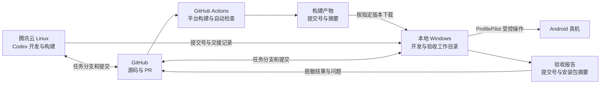

# ClipRelay 云端与本地协同开发技术方案

日期：2026 年 11 月 4 日

状态：设计方案，待实施

适用环境：腾讯云 4 核 8GB、本地 Windows 开发机、现有 Android 真机；云端不运行模拟器。

采用 GitHub 作为源码交换中心。云端负责开发、编译和通用自动化测试，本地负责带签名的 Android 构建、真机调试和 Windows 实际功能验收。每项任务使用独立分支，每次验收绑定完整 Git 提交号和安装包摘要。

首期保留本地构建能力，先打通源码交接和真机验收。后续再增加云端产物下载、本地签名和受控任务执行，逐步减少本地重复编译。4 核 8GB 的容量按一个构建任务、有限编译并发规划，最终以实际峰值内存和耗时校准。

## 一 目标与实施边界

目标是让两端可以同时开发不同任务，也能轮流接手同一任务，并且能够回答：改动来自哪里、手机运行哪个版本、测试覆盖哪些内容、失败后从哪里继续。

| 事项 | 首期安排 |
| --- | --- |
| 云端与本地同时开发 | 不同任务使用不同分支和工作目录 |
| 同一任务交接 | 原负责人提交并推送，接手方核对提交号后取得修改权 |
| 云端环境 | 优先采用 x86_64 Linux；系统与实例类型实施时确认 |
| Android 测试 | 云端跑 lint 和单元测试，本地连接现有真机 |
| Windows 功能 | Windows CI 和本地桌面环境分别承担自动检查、实际验收 |
| Mac 功能 | 保留 macOS CI；按现有约定，本次不增加 Mac 真机验收 |
| 正式发布 | 与日常开发验证分开执行 |
| 手机远程自动执行 | 后续自动化阶段实现；首期由本地操作者或本地 Codex 承接 |

本方案不迁移现有配对服务、更新服务或生产数据。腾讯云是否同时承载已有服务，需要在实施前确认；开发构建不应挤占这些服务的资源。

## 二 仓库现状与必须处理的问题

| 当前事实 | 对方案的影响 |
| --- | --- |
| 已有远程仓库 `https://github.com/ffffhx/cliprelay.git` | 复用现有远程，无需另建同步仓库 |
| 本地 `main` 工作区存在多项未提交修改和未跟踪源码 | 首先整理源码快照，否则云端克隆会遗漏本地功能 |
| [Android CI](../.github/workflows/android.yml) 已构建 Go 网络库、执行 lint 和单元测试、生成 APK | 复用命令与工具版本；增加提交号和产物信息 |
| [Gradle](../android-app/gradle.properties) 最大堆为 2GB，未显式限制 worker 数 | 云端增加任务级并发限制，不能把 2GB 当作总内存占用 |
| [Android Release](../.github/workflows/android-release.yml) 监听相关路径的 `main` 推送，并包含版本递增、发布逻辑 | 日常合并前先拆分验证与发布触发条件 |
| 部分桌面 CI 只匹配历史 `codex/...` 分支 | 新任务分支不一定触发；需调整触发器或显式调度并核对构建提交 |
| [.gitignore](../.gitignore) 已排除 SDK、缓存、产物、本地 SDK 路径和签名文件 | 延续源码与环境隔离，补充规则前逐项检查未跟踪文件 |
| [Android 构建配置](../android-app/app/build.gradle.kts) 中 `qa` 继承 release 签名，默认 debug 使用另一套签名 | 不能假定云端 debug APK 可覆盖现有手机安装 |
| [清理脚本](../scripts/clean_artifacts.ps1) 使用 Windows 路径和进程查询 | Linux 需要独立适配，不能直接承诺原脚本可运行 |
| [AGENTS.md](../AGENTS.md) 含 Windows 启动规则 | 未来按操作系统和操作类型划分适用范围，保留 Windows 原有要求 |

版本、分支和未提交状态属于编写方案时的快照。实施时重新读取，避免覆盖期间产生的新改动。

## 三 总体架构



两台电脑各自拥有完整 Git 克隆；`git worktree` 只在所在机器内提供额外工作目录，不承担跨机器同步。跨机器使用提交、推送和拉取。[Git worktree 文档](https://git-scm.com/docs/git-worktree)

Git 记录源码与必要的小型任务说明；构建包通过 CI artifact 或已认证的文件传输交换。依赖缓存、运行配置和手机连接状态留在各自环境。

## 四 分支与任务交接

### 分支约定

| 分支 | 用途 | 修改规则 |
| --- | --- | --- |
| `main` | 已集成、通过相应检查的开发基线 | 通过 PR 合并；发布仍是独立动作 |
| `feat/<task-id>-<subject>` | 新功能 | 一项任务一条分支 |
| `fix/<task-id>-<subject>` | 缺陷修复 | 一项任务一条分支 |
| `migration/<date>-local-baseline` | 首次迁移时保存现有源码 | 审查并拆分集成后归档 |

采用短期任务分支，不设置长期 `cloud`、`local` 两套产品主线。独立改动分支完成后合并，避免持续维护两个相互偏离的版本。[Git 工作流文档](https://git-scm.com/docs/gitworkflows)

每条任务分支同一时间只有一个写入负责人。负责人可以是云端或本地，但“云端正在处理”不代表本地也能往同一分支追加修改。其他环境可以只读检查该分支的固定提交。

### 同时开发不同任务

例如云端负责 `feat/CR-101-terminal-reconnect`，本地负责 `feat/CR-102-device-menu`。两项任务从同一已知基线出发，分别提交和验收。第一项合并后，第二项负责人将最新 `origin/main` 合入自己的任务分支，处理冲突并重新执行受影响检查。

两个任务如果都涉及协议定义、数据库结构、版本号或相同 UI 文件，应先约定边界。协议共享改动优先作为基础 PR 合并，再让后续任务更新基线。

共享分支默认用普通合并保留历史，不自动 rebase 或强推。推送被拒绝时先核对双方提交，再解决分歧；不通过覆盖远端消除冲突。

### 同一任务换机器继续

1. 当前负责人完成一个可理解的检查点，检查差异，只提交该任务相关文件。
2. 更新任务交接记录，写明已完成内容、待办、执行过的测试、已知问题和下一负责人。
3. 推送任务分支，取得包含交接记录的完整提交号，并将该提交号交给接手方。
4. 接手方 fetch 后核对分支和提交号，确认自己的工作目录没有混入其他任务改动。
5. 接手方确认接管后开始写入，原负责人保持只读。

未提交修改和本地 stash 不会因普通 push 自动到达另一台机器；任务未完成时可以推送明确标为 WIP 的任务分支提交，但不把 WIP 合入 `main`。

### 任务记录

建议为每项任务维护 `docs/tasks/<task-id>.md`，由当前负责人更新。示例字段：

```text
任务：CR-101 终端断线重连
分支：feat/CR-101-terminal-reconnect
当前负责人：cloud
状态：ready-for-local-validation
基础提交：<完整提交号>
已完成：...
下一步：...
允许修改的范围：...
本地验收步骤：...
已执行检查及结果：...
已知限制：...
产物清单或报告位置：...
```

交接记录提交后的最终 SHA 放在交接消息、PR 或外部回执中，不要求文档记录自身提交号。验收报告另行记录被测源码 SHA。

任务文档是交接约定，不是分布式锁。首期依靠明确接管确认，后续任务服务再提供原子领取。各端 Codex 会话通过任务记录获得上下文，Git 不负责同步聊天历史、登录状态和运行中的进程。

## 五 工作目录与云端资源

每台机器建议采用以下布局：

```text
<workspace>/
  cliprelay/                       主克隆，保留现有本地路径
  cliprelay-worktrees/
    CR-101/                        任务分支工作目录
    CR-102/                        另一项任务工作目录
    accept-CR-101-<short-sha>/      固定提交的验收源码目录
```

源码 worktree 不放进产物清理目录。每个 worktree 的缓存和构建中间文件由其自己的工具链管理，不能共享同一个可写 `build/` 目录。

验收源码目录使用 detached HEAD 固定到指定提交。如果需要现场改代码，先协商接管原任务，或者创建独立修复分支；修改后的包视为新版本，重新记录提交号。

### 云端工具链

按目标提交的工作流、Gradle Wrapper 和构建脚本安装。方案编写时的基线为：

| 工具 | 仓库当前使用 |
| --- | --- |
| JDK | 17 |
| Go | CI 为 1.26.7，具体以目标提交要求为准 |
| Gradle | Wrapper 9.4.1，包含发行包 SHA256 |
| Android SDK | CI 安装 `platforms;android-37.0`、`build-tools;37.0.0` |
| Android NDK | 29.0.14206865 |
| Node.js | 现有工作流使用 22 系列，按所执行流程安装 |
| Python | Python 3，执行仓库构建脚本 |

不复制 Windows 的 `local.properties` 到 Linux；通过本机 SDK 路径配置。仓库已跟踪的第三方资源保留现有 [.gitattributes](../.gitattributes) 字节规则，避免批量换行转换破坏完整性校验。

### 4 核 8GB 的初始配置

- 同时运行的重构建任务为 1；Codex 可以等待构建结果，但不并行启动第二次 APK 构建。
- Gradle 从 `--max-workers=2 --no-parallel --no-daemon` 起步，保留当前 2GB 堆设置。
- Go 从 `GOMAXPROCS=2`、`GOFLAGS=-p=2` 起步。Node 测试在适用时限制 test concurrency。
- 通过本机配置分别限制 Kotlin 和原生编译并发，并读取实际构建日志确认；Gradle worker 上限不等于所有子进程的总并发上限。
- 磁盘按至少 80～100GB 可用空间规划，属于容量预算。SDK、NDK、Go 模块缓存与产物分别计量。
- 日常针对变更跑相关测试；合并前补齐对应 CI，不在每次编辑后同时执行所有平台任务。

首轮记录冷构建与增量构建耗时、整个构建进程组峰值内存、剩余内存、磁盘增长和 OOM 情况。若构建期间频繁换页或无法留出约 1～2GB 的系统余量，先降低并发，再评估 16GB；不将交换空间视为等量物理内存。

## 六 构建与真机验收流程

### 首期采用本地签名构建

1. 云端在任务分支完成开发，运行与改动相关的测试、Android lint 和 APK 构建检查。
2. 云端提交、推送，交接完整源码 SHA、构建命令、工具链版本与测试结果。
3. 本地创建该 SHA 的验收 worktree。使用独立目录重新生成网络 AAR 和其他必要产物，避免混入另一分支的旧输出。
4. 本地使用现有签名配置生成适合当前手机安装的 `qa` 或 release 包；具体变体以验收目标决定。
5. 对最终 APK 计算 SHA256，检查应用 ID、版本号和签名证书是否与安装目标匹配。
6. 通过本地 ProfilePilot 安装，核对实际安装状态，再运行授权范围内的真机测试。
7. 保存提交号、安装包 SHA256、设备和环境摘要、测试步骤、结果及必要截图。问题反馈回原任务负责人。

即使两端源码 SHA 相同，也不假定本地重建包与云端包逐字节一致。实际验收结论绑定最终安装 APK 的摘要及其构建环境。

### Android 签名与版本

当前应用 ID 为 `com.cliprelay.app`。Android 更新安装会校验签名证书；来自不同默认 debug keystore 的 APK 不能直接视为可互相覆盖的安装包。[Android 签名要求](https://developer.android.com/studio/publish/app-signing#considerations)

首期签名密钥保留在已有受控环境，不上传 Git。验收开始前确认现有安装的签名和版本，不通过卸载来自动处理签名不匹配，也不通过删除应用数据解决问题。旧任务包的版本低于已安装版本时，记录阻碍并重新生成合适的验收包。

`qa` 在现有配置中使用 release 签名，但关闭混淆和资源压缩，适合相应功能调试；QA 通过不能替代需要验证压缩行为的 release 验收。仪器测试 APK 与目标 APK 的签名、变体和 runner 必须匹配。

后续产物交接阶段可将大部分编译移到云端：云端生成约定变体的未签名 APK，本地按 Android 工具链完成对齐、签名和校验。清单同时记录签名前后摘要。该链路需先验证产物格式、变体、测试 APK 和现有安装兼容性，再替代首期本地构建。

开发分支不自行争抢正式版本号。正式版本由发布流程统一分配；日常测试使用源码 SHA 和安装包摘要区分。未来若需要独立测试包名，应单独检查权限、provider、更新地址和服务配置，不能仅凭添加后缀假定可用。

### 真机控制入口

手机连接本地 Windows，ProfilePilot 桌面 App 和其手机控制能力也在本地运行。云服务器不直接继承本地 USB 或无线调试连接。

- 每次任务先读取本地 ProfilePilot 技能、个人手机偏好和 `ppilot phone --help`，再通过 `ppilot phone list`、readiness 核对实际设备与会话。
- 已签名 APK 使用 `ppilot phone install`；该命令自行管理安装会话，不在它前面创建冲突的控制会话。
- UI 操作使用受支持的 `ppilot phone` 接口；已有测试脚本只在确认命令受支持后通过 `ppilot phone wrap` 纳入会话。硬编码原生 ADB 路径或直连 ADB socket 的脚本不能假定已被接管。
- 当前设备身份、会话 generation、连接路径均以实时查询结果为准。设备占用、用户暂停或接管时停止写操作；不换工具绕过，也不自动续跑结果不明的安装或输入。
- 同一手机和同一本地 ClipRelay 安装环境，每次只允许一个会改变状态的验收任务。只读结果回传不拥有设备控制权。

手机能力以本机的 ProfilePilot 指引为准：`C:/Users/aa182/.agents/skills/profilepilot/SKILL.md` 与其 `local/phone-control.md`、`references/phone.md`。这些绝对路径属于本地配置，不复制为云端的执行路径。

### Windows 与跨端验收

Windows 安装和启动遵循 [项目进程规则](../AGENTS.md)：使用受支持的 `start.ps1` 独立启动；启动命令退出后，确认 Electron 主进程、后台进程和配置端口仍存活。共享本地安装的任务串行执行，测试结束后记录恢复到哪个版本。

涉及协议变更时，报告同时记录手机 APK 和电脑端版本。桌面串流、系统剪贴板、输入法、真实网络和设备手势在对应环境验证；通用单元测试只证明其覆盖的逻辑。

## 七 同步对象与产物记录

| 对象 | 交换方式 | 约束 |
| --- | --- | --- |
| 源码、脚本、测试、通用 Agent 规则 | Git 分支与 PR | 只提交相关、可审查的文件 |
| 任务交接和验收摘要 | 小型 Markdown、PR 描述或任务系统 | 不含账号、设备私钥和原始个人内容 |
| APK、Windows 包、校验清单 | GitHub Actions artifact 或认证文件传输 | 按源码 SHA、运行编号和产物摘要定位 |
| 截图、日志、详细报告 | 本地验收目录；按需上传受控存储 | 先核对内容与访问范围，不默认上传公共 artifact |
| SDK、NDK、Gradle 与 Go 缓存 | 各机器维护 | 可按版本缓存，不跨系统直接覆盖 |
| `local.properties`、运行配置、配对状态 | 各环境维护 | 只共享脱敏模板 |
| 签名密钥、Git 凭据、Codex 凭据 | 各受控环境单独配置 | 不写入仓库、任务单或构建日志 |

GitHub Actions 已支持保留和下载构建、测试产物；开发包使用 artifact，不通过创建正式 Release 进行临时同步。[GitHub artifact 文档](https://docs.github.com/en/actions/tutorials/store-and-share-data)

每次产物清单至少包含以下字段。下例是字段模板，尖括号需替换为实际值：

```json
{
  "schemaVersion": 1,
  "taskId": "CR-101",
  "sourceCommit": "<40 位 Git 提交号>",
  "branch": "feat/CR-101-terminal-reconnect",
  "sourceDirty": false,
  "buildVariant": "qa",
  "buildPlatform": "windows-x64",
  "builtAtUtc": "<ISO 8601 UTC 时间>",
  "applicationId": "com.cliprelay.app",
  "versionCode": "<实际整数，生成时使用 JSON number>",
  "signerSha256": "<签名证书摘要>",
  "toolchain": {
    "java": "<实际版本>",
    "go": "<实际版本>",
    "gradle": "<实际版本>",
    "ndk": "<实际版本>"
  },
  "artifact": {
    "file": "<实际安装包文件名>",
    "sha256": "<64 位 SHA256>",
    "bytes": "<实际整数，生成时使用 JSON number>"
  },
  "checks": [
    {"name": "<检查名称>", "status": "passed", "report": "<报告相对路径>"}
  ]
}
```

依赖手工未提交补丁的包应标记 `sourceDirty: true`，仅用于临时诊断，不作为合并或正式发布的验收依据。下载按明确的 workflow run 和 artifact 标识选择，不能用不断变化的 `latest` 代表某次验收。

### 本地产物保留

延续 [AGENTS.md](../AGENTS.md) 的目录和预算：

- 验收输出放 `.tools/artifacts/acceptance/<task-time>/`；最多最近 2 次、最长 7 天、合计 2GiB。
- 包放 `.tools/artifacts/packages/{windows,android,macos}/<version-time>/`；各平台最近 2 份，Windows 和 macOS 各 2GiB，Android 1GiB。
- Windows 构建和验收前运行 `scripts/clean_artifacts.ps1` 预览，结束后加 `-Apply` 执行保留规则并记录结果。
- 最近 24 小时修改、正在使用或带 `.keep` 的目录按现有规则跳过；已经确认不再使用的完整临时安装副本按任务收尾清理。
- 云端先用新建、明确列出的产物目录，部署前补齐等价的 Linux 清理入口和平台规则。Linux 清理应检查真实路径、链接、使用状态和 `.keep`；无法确认使用状态时保留并报告。

清理器不管理源码 worktree、SDK、当前安装、密钥和备份。删除 worktree 前另行核对未提交文件、进程引用和保留需求，使用 Git 支持的 worktree 管理入口。云端容量报告需汇总所有 worktree 的缓存和产物，避免单个目录达标而总磁盘持续增长。

## 八 CI 集成与正式发布

首期实施时先调整 CI，再将双方开发成果合入 `main`：

1. Android 验证工作流覆盖 `feat/**`、`fix/**` 相关 PR 和手动验证，显式记录实际 checkout 的提交。PR 验证提交与分支 head 不同时分别记录。
2. 桌面验证流程补充新分支和 PR 入口；按变更范围选择 Windows、macOS、Linux 检查。原有只匹配历史分支的流程不能视为已经自动覆盖。
3. Android 正式发布调整为明确发布入口，例如发布标签或带固定提交输入的手动任务；去掉普通 `main` 推送自动发布的耦合。同步核对 `android-cloud-sync.yml`，保持生产更新只接收正式发布产物。
4. 发布前在准备提交中确定唯一版本号，再对该提交完成检查；发布构建固定到这一 SHA，不在验收之后悄悄重取移动中的 `main` 或更改版本文件。
5. Windows 发布同样记录固定源码 SHA、产物摘要与版本。日常构建不得调用会发布或同步生产更新的流程。
6. `main` 通过适用检查后合并，尽量使用仓库可用的分支保护；相关设置权限实施时核对。

合并造成冲突解决或源码变化后，重新验证受影响部分。最终集成提交仍需运行适用检查，不能把两个独立分支分别通过等同于合并版本已经通过。正式发布包与验收包变体不同时，补做对应发布构建检查和必要的实际验收。

## 九 后续自动化调试通道

首期不要求公网手机调试接口。云端提交交接记录，本地在已授权任务内执行并回传结果，就可以完成开发闭环。

后续可增加一个本地任务执行器，由本地主动连接已认证的任务通道领取工作。执行器运行在能访问 ProfilePilot 的本地用户环境，使用固定动作和参数，不接收任意远程 shell 字符串。该执行器是拟新增能力，不假定现有 Linux CLI 已能直接操控 Windows 上的手机。

建议支持的动作包括：准备固定提交、运行已登记构建、校验安装包、安装、运行指定测试、读取范围受限的日志、回传报告。任务必须绑定源码 SHA、包摘要、设备身份、测试集和有效期；签名信息与凭据从本地受控配置读取。执行器只接受指定仓库和已认可的提交来源，公共 PR 不自动取得本地执行或签名权限。

任务状态为 `queued → claimed → running → passed / failed / paused / cancelled / uncertain`。设备使用权在本地统一串行管理；领取使用原子操作，不能把 Git 文件当作可靠锁。每个任务有唯一 ID 和执行回执，断网后先查询结果；`uncertain` 的安装、输入和应用重启不能自动重放。

用户暂停或接管始终优先于队列。任务超时、过期、设备变化或 ProfilePilot 会话失效时停止后续动作。本地离线时保留云端构建结果，等待恢复后重新检查任务是否仍适用。

这一阶段只有在手机任务范围、允许自动执行的动作和本地会话规则已明确授权后启用；本方案本身不启动调试任务。

## 十 实施阶段与验收标准

| 阶段 | 工作内容 | 完成标准 |
| --- | --- | --- |
| P0 整理现有工作 | 盘点未提交和未跟踪内容，审查源码与临时文件，保存迁移分支，核对远端变化 | 新目录克隆该分支后包含要保留的源码；敏感配置和产物未进入提交 |
| P1 建立协作基线 | 任务分支、worktree、任务模板、CI 触发和发布解耦、跨平台 Agent 与清理规则 | 一个云端任务和一个本地任务能独立工作，普通验证不发布更新 |
| P2 配置云端 | 核对实例和磁盘、安装固定工具链、配置独立凭据和资源限制 | 在指定干净提交上通过相关测试与一次 APK 构建，无 OOM，记录资源占用 |
| P3 跑通真机交接 | 云端推送、本地固定提交构建签名、ProfilePilot 安装和验收 | 报告能对应源码 SHA、APK SHA256、签名、手机版本及测试结果 |
| P4 减少重复构建 | 云端未签名产物、本地签名、下载清单和回执工具 | 安装的是校验后的指定包，传输损坏或签名不匹配会被识别 |
| P5 自动执行交接 | 本地任务队列、设备串行、暂停处理和结果核对 | 重复任务不重复写入；用户接管立即生效；断网后不盲目重试 |

先完成 P0～P3，即可用于日常双端开发；P4、P5 依据实际重复劳动决定是否实施。

### 联合验收场景

1. 两端修改不同任务，分别提交，先后合并后无源码丢失。
2. 同一任务从云端交给本地，接手方精确获得交接提交和待办；原端停止写入。
3. 本地有未提交开发内容时，可以在另一 worktree 验收云端提交，原目录内容不变。
4. 两端修改同一区域时出现正常冲突，负责人解决后重新检查，不自动选择覆盖一方。
5. 手机安装包摘要与报告一致，签名匹配，已有应用数据保留；qa 与 release 的覆盖范围分别说明。
6. 手机被占用或用户暂停时，后续安装和输入停止；未知结果先核对后续动作。
7. 云端一次冷构建、一次增量构建和相关测试能够完成，磁盘保留策略生效且未触碰源码与密钥。
8. 普通任务推送与 PR 验证只产出检查和开发包；生产更新地址及 Release 未发生变化。
9. 集成提交重新通过适用检查，发布操作固定到已确定版本和提交。

### 失败处理

| 情况 | 处理 |
| --- | --- |
| 推送失败或双方提交分叉 | 保留本地提交，fetch 后由负责人合并；不强制覆盖 |
| 云端构建 OOM | 停止并发构建、保留日志，降低 worker 与原生并发，再决定扩容 |
| 本地重建结果与云端不同 | 比较源码 SHA、工具链、变体、网络 AAR 和签名，不凭文件名判断相同 |
| 手机签名或版本不匹配 | 保留现有安装和数据，重新选择正确构建；不自动卸载或降级 |
| 验收失败 | 反馈到原任务分支，产生新提交和新清单；旧报告保留原结论 |
| 已合并代码回退 | 用新的 revert 提交恢复代码并重新验证；设备安装回退另行处理兼容性 |
| 任务中断或本地离线 | 保存结果和进度，恢复时核对任务、提交、安装状态及控制权 |

## 十一 实施时可使用的命令示例

以下是实施手册示例，本方案未执行这些同步、构建或安装操作。先完成 P0 与对应环境准备；示例中的任务名和路径需替换为实际值。

云端从远端基线创建独立任务目录：

```sh
git fetch origin
git worktree add -b feat/CR-101-terminal-reconnect ../cliprelay-worktrees/CR-101 origin/main
```

本地创建固定提交验收目录，可从原仓库执行，不切换原开发目录分支：

```powershell
$sourceCommit = '<交接记录中的完整提交号>'
git fetch origin
git show --no-patch --oneline $sourceCommit
# 核对提交存在且与交接一致后执行。
git worktree add --detach ../cliprelay-worktrees/accept-CR-101 $sourceCommit
```

Linux 构建命令骨架，前提是已完成 Linux 清理入口适配，并先执行该入口的占用预览。每步失败即停止，工作目录从该任务 worktree 根开始：

```sh
set -e
export GOMAXPROCS=2
export GOFLAGS='-p=2'
cd network
go test ./...
cd ..
python3 scripts/build_network.py android
cd android-app
./gradlew lintDebug :app:testDebugUnitTest assembleDebug --max-workers=2 --no-parallel --no-daemon
```

这是与当前 Android CI 对齐的验证骨架，实际任务可先跑相关测试。`assembleDebug` 的成功不代表其签名适合手机现有安装。若用 `--android-arch android/arm64` 缩短网络库迭代构建，须先确认目标 ABI，并另行配置 APK 原生库的 ABI 范围；网络脚本参数不会自动限制整个 APK。

Windows 构建或验收前后的清理分别使用：

```powershell
powershell.exe -NoProfile -ExecutionPolicy Bypass -File scripts/clean_artifacts.ps1
# 构建或验收完成、必要证据保留后执行。
powershell.exe -NoProfile -ExecutionPolicy Bypass -File scripts/clean_artifacts.ps1 -Apply
```

安装前先核对当前 ProfilePilot CLI 支持的参数、设备和已有会话，安装示例为：

```text
ppilot phone list
ppilot phone readiness --device <实际设备ID>
ppilot phone install --device <实际设备ID> --apk <已校验签名和摘要的APK绝对路径> --controller Codex
```

安装和测试是实际设备操作，须处于用户授权的对应任务范围内，并遵循本地控制偏好。
